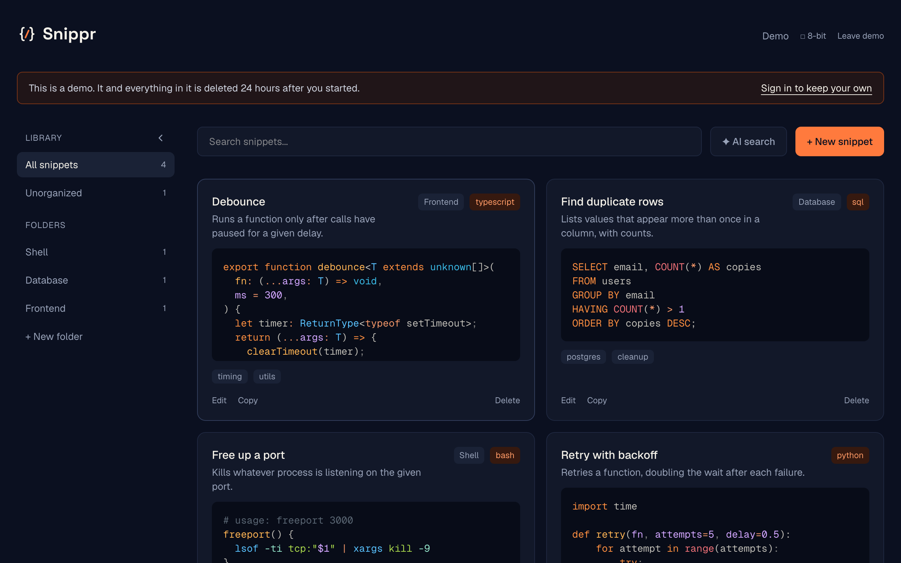
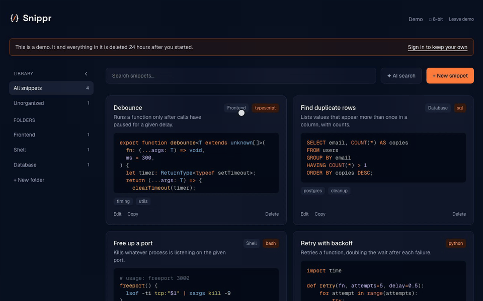
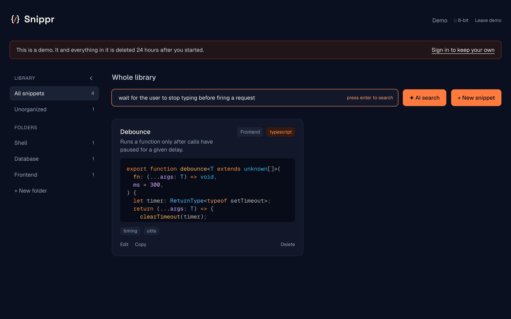
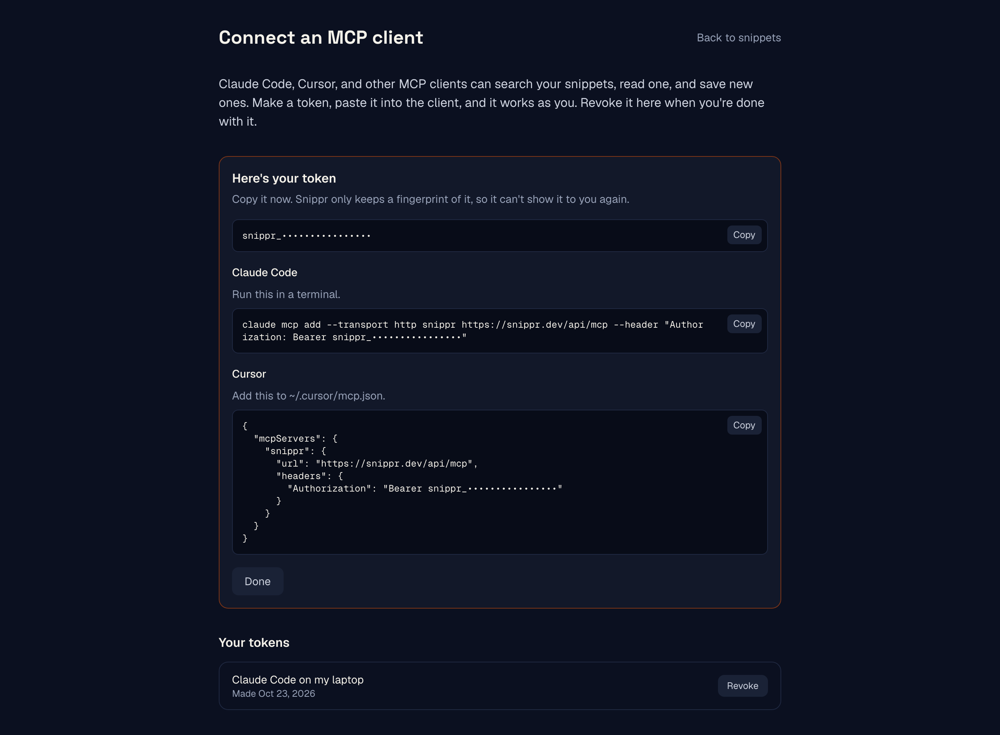
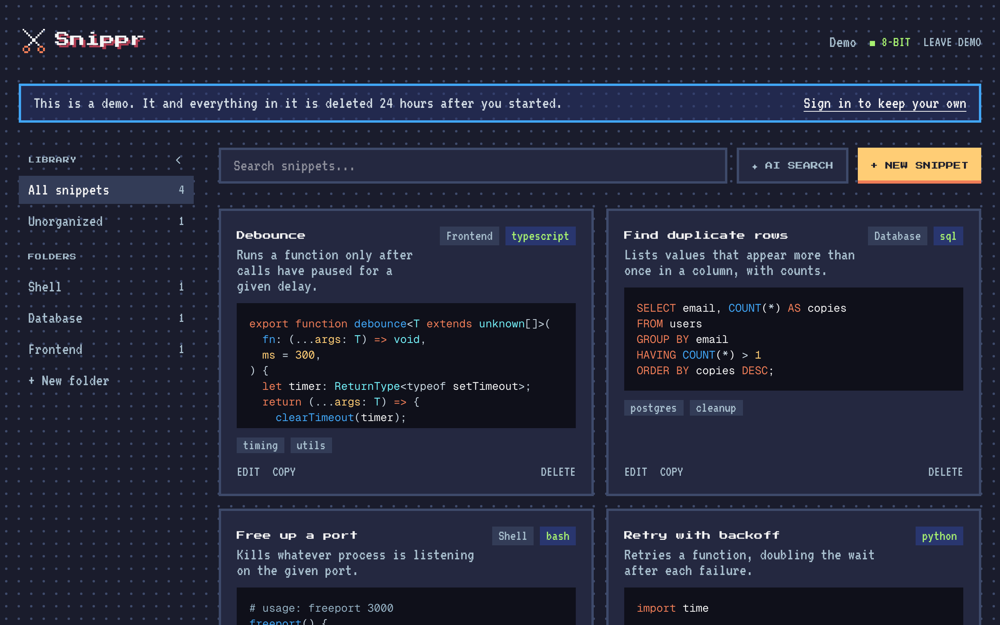
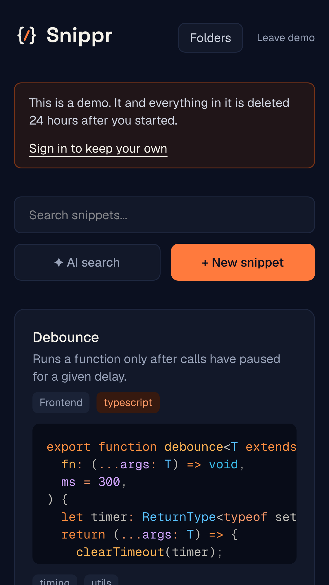
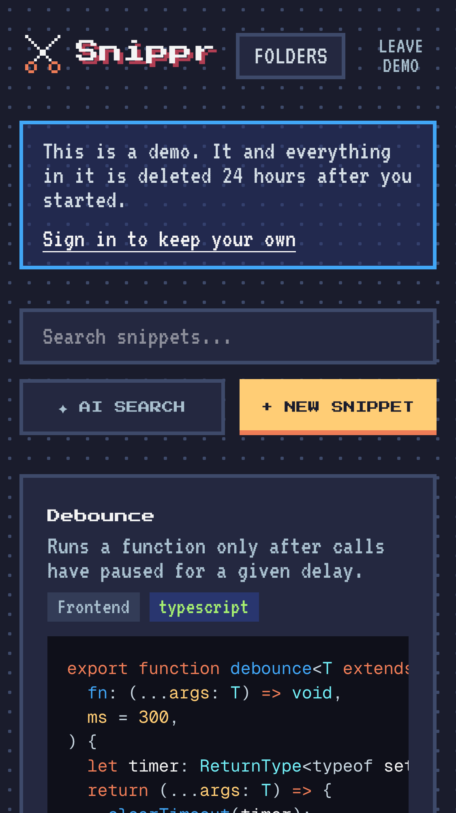
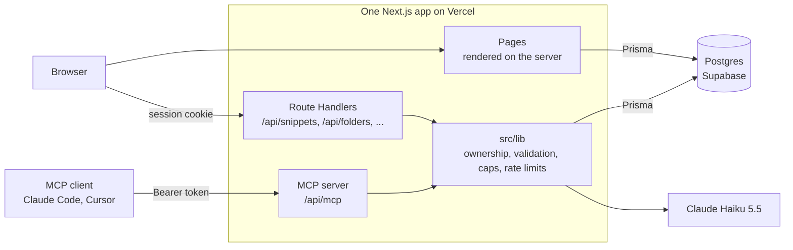

# Snippr

A code snippet manager you can search by describing what the code does. Claude Code and Cursor can search it too.

**[snippr.dev](https://snippr.dev)**. The demo there needs no account and deletes itself after 24 hours.



Snippr is a portfolio project, so the reasoning is part of what's on show. Every significant choice has a [decision record](docs/adr/README.md) saying what else was considered and what it costs, and the [architecture doc](docs/ARCHITECTURE.md) describes how it all fits together today.

## What it does



- **AI search.** Turn on ✦ AI search, describe the code, and press Enter. Claude reads your library and returns what matches, even when none of your words are in the snippet. With it off, the box filters by title, tag, and language as you type.
- **AI descriptions.** Paste code, press ✦ Generate, and Claude writes one sentence about what it does.
- **Folders.** Drag a card onto a folder. On a phone, where a finger drag scrolls, the folder field in Edit does the same job.
- **An MCP server.** Claude Code, Cursor, and other MCP clients can search, read, and save snippets in your library.
- **Two themes.** A dark default and an 8-bit one, remembered between visits.
- **Highlighted code** on every card and in the preview, by Shiki.
- **A demo** in one click, with a small library to try things on.
- **A phone layout** where the folders move into a drawer and nothing scrolls sideways.

Accounts hold 50 snippets, and the demo holds 10.

### AI search



"Wait for the user to stop typing before firing a request" doesn't share a word with "Debounce: runs a function only after calls have paused for a given delay." Claude gets the query and a numbered list of every snippet's title, language, tags, and description, and answers with the numbers that match. Results come from the whole library, and the heading says so.

### Your snippets in Claude Code or Cursor



Make a token on the Connect page, paste one line into your client, and ask it for "my debounce snippet" from any project. The server has three tools:

| Tool | Does |
| --- | --- |
| `search_snippets` | AI search over your whole library |
| `get_snippet` | One snippet by id |
| `save_snippet` | Saves a new snippet, with the same limits as the app |

Tokens are stored as hashes and shown once. Each tool calls the same function as the matching API endpoint, so the ownership checks, the snippet cap, and the AI rate limit apply without a second copy of them.

### Two themes

<table>
  <tr>
    <td width="64%"></td>
    <td width="18%"></td>
    <td width="18%"></td>
  </tr>
</table>

Both themes are the same components on different values. Components only use tokens named by role (`bg-surface`, `text-fg-muted`), and the 8-bit theme is one block of CSS that overrides them, with its own fonts and syntax colors. The choice is kept in a cookie, so the server sends the right theme with the first byte and nothing flashes.

## How it's built



The parts most worth reading, each with the decision record behind it:

- **Every query is scoped to its user.** Each endpoint resolves the user first (`401` without one), checks ownership of every record it touches by id (`403`), and puts `userId` in the `where` clause of every read and write. The rules live in `src/lib`, tested against an in-memory store with two users, and the database side is tested against a real Postgres, so a query that forgets `userId` fails ([0018](docs/adr/0018-route-handler-logic-in-lib-with-a-store.md), [0020](docs/adr/0020-ci-on-github-actions-gating-production-deploys.md)).
- **The MCP server reuses the API.** It's a route in the same app, signed in with personal access tokens, and stateless, so it runs on Vercel's functions ([0024](docs/adr/0024-remote-mcp-server-with-personal-access-tokens.md)).
- **Claude is called from one module.** Haiku 5.5 for both features, a 15-second timeout, one retry, and a `502` when it fails. Features take that call as an argument, so their tests use a fake Claude. Each user gets 30 calls an hour per feature, counted in Postgres ([0023](docs/adr/0023-one-ai-module-on-claude-haiku.md), [0011](docs/adr/0011-rate-limit-ai-endpoints-in-postgres.md)).
- **The demo is a real user that expires.** "Try the demo" creates a guest with a seeded library and a 24-hour session, limited to 5 starts an hour per IP. Expired guests are deleted when the next demo starts, so there's no scheduled job ([0012](docs/adr/0012-demo-mode-as-expiring-guest-users.md)).
- **Caps hold under parallel requests.** Creating a snippet, folder, or token counts and inserts under a per-user Postgres advisory lock, so 20 requests at once can't get past a cap. A database test fires exactly that at each one ([0025](docs/adr/0025-serialize-snippet-creates-per-user-with-an-advisory-lock.md)).
- **Schema and code can't deploy out of order.** Production builds apply migrations before `next build`, and Vercel holds each deploy until CI passes: lint, types, unit tests, migrations on an empty Postgres, the database tests, and the end-to-end tests ([0016](docs/adr/0016-apply-migrations-in-the-production-build.md), [0020](docs/adr/0020-ci-on-github-actions-gating-production-deploys.md)).
- **Local development can't reach production.** The scripts that connect refuse a database that isn't on your machine ([0015](docs/adr/0015-local-postgres-in-docker-for-development.md)).
- **The themes are checked, not eyeballed.** A test checks every text and background pairing against WCAG AA in both themes, and another fails on any form field or button without an accessible name ([0027](docs/adr/0027-one-default-identity-and-an-8-bit-theme-on-semantic-tokens.md), [0029](docs/adr/0029-remember-the-theme-in-a-cookie-and-highlight-code-in-both.md)).

The screenshots above are taken by a script against the real app, so they can be retaken whenever the interface changes ([0032](docs/adr/0032-generate-readme-images-from-the-app-with-playwright.md)).

### Stack

- **App:** Next.js 16 (App Router), React 19, TypeScript
- **Styling:** Tailwind CSS v4 on CSS-variable design tokens
- **Data:** Postgres on Supabase, through Prisma 5
- **Auth:** NextAuth v4 with GitHub and Google, database sessions
- **AI:** Anthropic SDK, Claude Haiku 5.5
- **MCP:** the official TypeScript SDK
- **Also:** zod for request bodies, Shiki for highlighting, dnd-kit for drag and drop
- **Tests:** Vitest for units and the database, Playwright end to end
- **Shipping:** GitHub Actions, then Vercel

## Run it locally

You need Node.js 20.12 or newer, Docker Desktop, a GitHub OAuth app, and an Anthropic API key. Google sign-in is optional.

```bash
git clone https://github.com/RyanDanielWalker/snippr.git
cd snippr
npm install
cp .env.example .env      # then fill it in
npm run db:up             # Postgres in Docker
npm run db:migrate        # create the tables
npm run dev               # http://localhost:3000
```

The [development guide](docs/DEVELOPMENT.md) explains each environment variable, the test suites, and how changes ship.

## Documentation

- [Architecture](docs/ARCHITECTURE.md): how the system fits together, with diagrams and a code map
- [Decision records](docs/adr/README.md): why it's built this way, and the trade-offs
- [Development guide](docs/DEVELOPMENT.md): setup, scripts, tests, and the working agreement
- [Roadmap](docs/ROADMAP.md): what's done, what's next, and what's parked
- [Audits](docs/audits/): reviews of the code and the live site, and what each one found

## License

[MIT](LICENSE). The fonts in `assets/fonts` keep their own licenses, the SIL Open Font License, in the files beside them.
