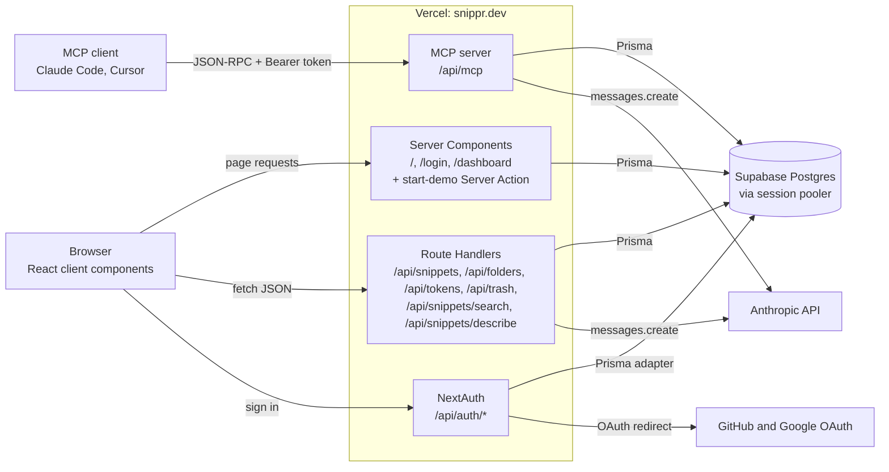
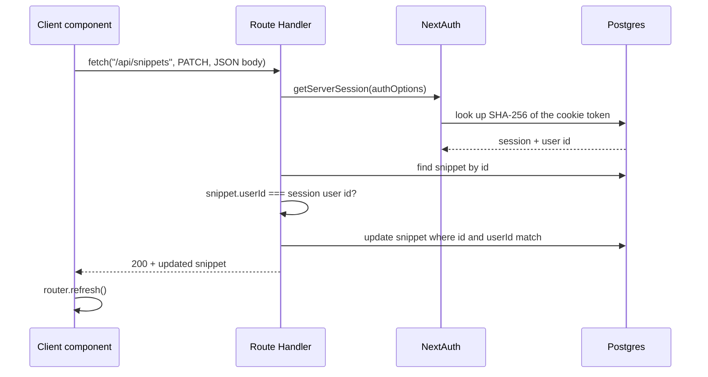
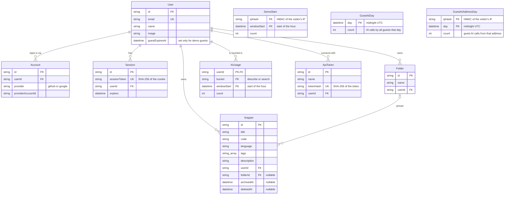
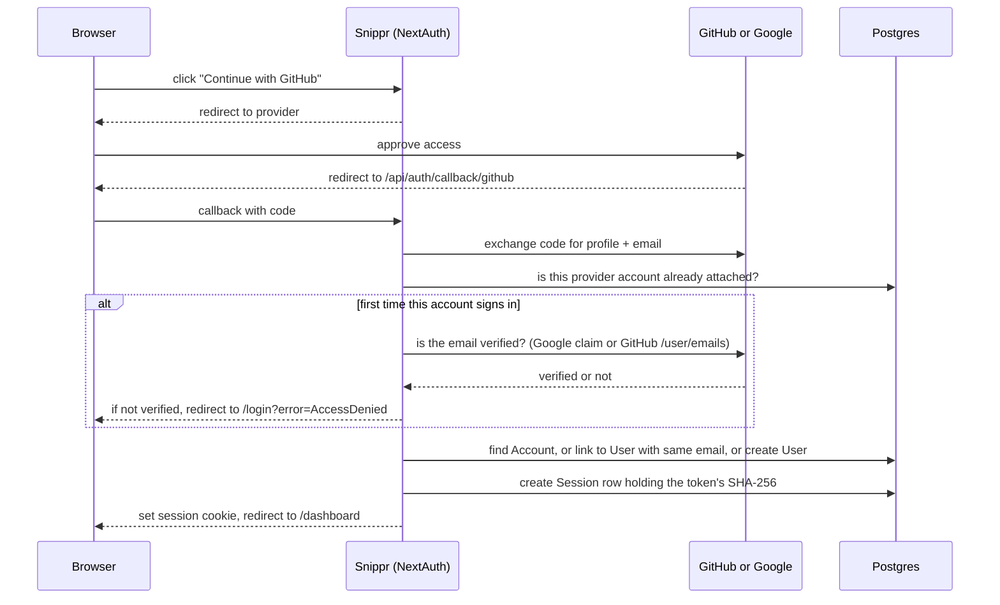

# Architecture

This document describes how Snippr is put together **today**. For *why* it's built this way, follow the links to the [decision records](./adr/README.md). For what's changing next, see the [roadmap](./ROADMAP.md).

*Last reviewed: 2026-11-19 (after ADR 0068)*

## The short version

Snippr is a single Next.js 16 application deployed on Vercel. Pages render on the server and read from a Supabase Postgres database through Prisma. The browser changes data by calling a small set of JSON endpoints in the same app. Two of those endpoints call the Anthropic API for AI search and AI-written descriptions. Users sign in with GitHub or Google through NextAuth, or start a 24-hour demo as a guest without signing in. MCP clients like Claude Code and Cursor reach the same library through an MCP server in the same app, signed in with a token the user makes. Every query that returns or changes a user's data is scoped to that user.

## System overview



| Piece | What it does | Decision |
| --- | --- | --- |
| Next.js App Router | Serves pages and the API from one app | [0002](./adr/0002-nextjs-full-stack-on-vercel.md) |
| Prisma 5 + Supabase Postgres | Stores users, sessions, snippets, folders | [0003](./adr/0003-supabase-postgres-with-prisma-5.md) |
| NextAuth v4 | GitHub and Google sign-in, database sessions | [0004](./adr/0004-nextauth-database-sessions-and-account-linking.md) |
| Anthropic API | AI search and AI descriptions | [0005](./adr/0005-ai-features-as-synchronous-claude-calls.md) |
| dnd-kit | Drag snippets onto folders, Unorganized, and Archive | [0007](./adr/0007-dnd-kit-for-drag-and-drop.md) |
| Demo mode | Expiring guest users, no sign-in needed | [0012](./adr/0012-demo-mode-as-expiring-guest-users.md) |
| Shiki | Syntax highlighting: cards on the server, the preview modal in the browser | [0022](./adr/0022-highlight-cards-on-the-server.md) |
| zod | Checks every API request body | [0014](./adr/0014-validate-request-bodies-with-zod.md) |
| MCP SDK | The MCP server MCP clients connect to, signed in by token | [0024](./adr/0024-remote-mcp-server-with-personal-access-tokens.md) |

## How a request flows

### Loading the dashboard (read path)

1. The browser requests `/dashboard`.
2. `src/app/dashboard/page.tsx` is a **Server Component**: it runs only on the server. It calls `getServerSession(authOptions)`, which reads the session cookie and looks the session up in Postgres. No session means a redirect to `/login`.
3. It empties the user's trash (see "Recently deleted" under the data model), then loads their snippets and folders (with snippet counts) in parallel with `Promise.all`, then highlights the start of each snippet's code with Shiki for its card ([0022](./adr/0022-highlight-cards-on-the-server.md)).
4. It passes that data as props to `DashboardClient`, a **Client Component** that runs in the browser and owns all the interactive state: search text, AI mode, selected folder, sidebar collapse, the phone folder drawer, the new-snippet modal, and drag state. Each `SnippetCard` owns its own preview and edit modals.
5. `DashboardClient` is rendered to HTML on the server too, so the snippets arrive with the page, and then **hydrates** in the browser: React attaches its event handlers to that HTML instead of drawing it again. That only works if both renders produce the same markup, which is why `DndContext` has a fixed `id` ([0007](./adr/0007-dnd-kit-for-drag-and-drop.md)). So a remembered choice the first frame depends on lives in a cookie the server can read, not in `localStorage`: the theme ([0029](./adr/0029-remember-the-theme-in-a-cookie-and-highlight-code-in-both.md)), the collapsed sidebar (`src/lib/sidebar.ts`, read by the dashboard page), and a demo guest's checklist ([0049](./adr/0049-a-things-to-try-checklist-for-demo-guests-kept-in-a-cookie.md)). A snippet's created date has the opposite problem: it depends on the reader's time zone, which the server can't know. So `CreatedDate` renders it in UTC on the server and during hydration, and `useTimeZone` (built on `useSyncExternalStore`) renders it again in the browser's zone straight after. The markup matches, and a snippet saved at 9pm in New York still says the 15th, not the 16th.

Filtering by folder and keyword search both happen **in the browser** over the snippets already loaded, and keyword search stays inside the open folder. The page loads archived snippets too, and `DashboardClient` keeps them out of every view except Archive, which sits in the sidebar's Library group under All snippets and Unorganized ([0056](./adr/0056-archive-snippets-with-an-archivedat-column.md), [0058](./adr/0058-group-the-archive-with-the-library-and-give-sidebar-rows-icons.md)). Deleted snippets work the same way, under a Recently deleted row below Archive ([0067](./adr/0067-recently-deleted-a-30-day-trash-emptied-when-the-library-loads.md)). Like Archive, that row shows only while it holds something. Before it reads anything, the page empties the trash: it purges this user's snippets deleted over 30 days ago (see "Recently deleted" under the data model). Only AI search makes a network call, and it always searches the whole library: you reach for it when you don't remember where something is, and the MCP server's search works the same way. While its results are up the heading reads "Whole library" instead of the folder's name, and picking a folder clears them. Its results are kept as ids and looked up in the loaded snippets, so they follow edits, moves, and deletes like the rest of the grid.

Each snippet is a card, and a card is an `<article>` named by its title ([0072](./adr/0072-snippet-cards-are-articles-opened-by-a-title-button.md)). An article is an HTML element for a self-contained piece of a page, like a post in a feed. A screen reader announces it ("Debounce, article") and can jump from one card to the next. The title inside the card's heading is a button, and it opens the preview. Edit, Move, Copy, Archive, and Delete are buttons beside it. A click anywhere on the card opens the preview too: Enter or Space on the title fires a click, which bubbles up to the card's own `onClick`, so the keyboard and the mouse take the same path. The card used to be a button itself, because dnd-kit's `useDraggable` hands back `role="button"` and `tabIndex=0` for whatever you drag, which put the card's buttons inside a button. Now only the drag's pointer `listeners` go on the card, and dnd-kit's instructions for screen readers (`CARD_INSTRUCTIONS`) are attached to the title button. A test walks the dashboard's server-rendered HTML with `controlsInsideControls` and fails on any control inside another.

Dragging a card is the other way to change where a snippet lives. A **drop target** is a place on the page that accepts a dragged item, registered with dnd-kit's `useDroppable`. The sidebar has one for each folder, one for Unorganized, and one for Archive. When a card is let go over one, `DashboardClient` asks `dropAction` (`src/lib/card-drop.ts`) what that means, and gets back one of three answers. For example, a card in Frontend dropped on Shell is `move` to Shell's id, dropped on Unorganized is `move` to no folder, and dropped on Archive is `archive`. Dropped back on Frontend, it's `none`, and nothing is sent. A move or an archive is one `PATCH` with only the field that changes, then a toast ("Moved to Shell." or "Archived."). Unorganized and Archive hide while they're empty, so the sidebar shows them while a card is being dragged, and keeps them up until the dropped card has landed. Without that, the first drop on either would have nowhere to go. Recently deleted isn't a drop target, because a drop would delete without the two-step confirm ([0067](./adr/0067-recently-deleted-a-30-day-trash-emptied-when-the-library-loads.md)).

A drag needs a mouse. The other way to move a snippet is the card's Move button, which works from the keyboard, with a screen reader, and on a phone, where a finger drag scrolls the page ([0073](./adr/0073-move-a-snippet-from-a-move-menu-not-a-keyboard-drag.md)). Move (`src/components/MoveMenu.tsx`) is a *disclosure*: a button that shows and hides a list next to it, and says which with `aria-expanded`. The list holds Unorganized and then each folder, from `moveChoices` in `src/lib/card-drop.ts`, with the snippet's current place marked `aria-current` and a check mark. Opening it puts focus on the first place, Up and Down move between places, and Escape closes it and puts focus back on Move. That behavior lives in a hook, `useDisclosureMenu` (`src/components/useDisclosureMenu.ts`), which the theme picker uses too. A *hook* is a function whose name starts with `use` that a component calls to get state and behavior. Here it hands back whether the list is open, refs for the button and the list, and the handlers for the keys, a click outside, and tabbing out. The component draws its own button and list. Each place's id is the drop id a drag onto that row would give. So a pick and a drop both go through `moveSnippet` in `DashboardClient`, which asks `dropAction` what to do and sends the same `PATCH`, with the same toast. For example, picking Shell in Debounce's list does exactly what dropping Debounce on the Shell row does. Move isn't on archived or deleted cards, which can't be dragged either, or when there are no folders.

A screen reader also hears what's happening during a mouse drag. dnd-kit's default lines read out the dragged item's id, and a card's id is its database id ("Picked up draggable item cm2…"). `dragAnnouncements` in `src/lib/card-drop.ts` replaces them with the snippet's title and the row's name: "Picked up Debounce.", "Over Shell.", "Dropped Debounce on Shell." Whether the move worked is left to the toast.

The sidebar can collapse to an *icon rail*, a 56px strip of squares, one per row, with each folder shown as its first letter ([0059](./adr/0059-collapse-the-sidebar-to-an-icon-rail.md)). For example, a folder named Shell becomes an "S" square whose tooltip says "Shell (2)". The squares are still drop targets, so dragging works the same with the sidebar collapsed. Renaming, deleting, and making folders wait for the full sidebar.

The open row is marked twice, once for the eye and once for a screen reader. The accent background is a CSS class, and a screen reader can't see a class. So the same button also carries `aria-current="true"`, an attribute that makes a screen reader say "current" after the button's name. For example, with Shell open, tabbing down the sidebar reads something like "All snippets 9, button", then "Shell 2, current, button". The exact words vary by screen reader. That matters most on All snippets, which has no heading above the cards to say where you are. It's on every row in the full sidebar, the phone drawer, and the rail. The value is `"true"` rather than `"page"`, because picking a row changes what the dashboard shows, not the URL.

Below the `md` width (768px) the sidebar is a drawer that slides over the cards, opened by the Folders button. While it's open it's a **dialog**, the same way the preview and the edit form are ([0071](./adr/0071-close-1-4-and-scope-1-5-to-accessibility.md)). For a screen reader, a dialog is a part of the page that has taken over until it closes. Three things make it one:

- **The role.** The drawer gets `role="dialog"`, `aria-modal="true"`, and the name "Folders", so VoiceOver says something like "Folders, dialog" as it opens.
- **Focus.** `useDialogFocus` moves focus onto the drawer when it opens and back to the Folders button when it closes.
- **An inert page.** `inertOutside` (`src/lib/dialog-focus.ts`) sets the HTML `inert` attribute on everything outside the drawer. An inert element can't be clicked, focused, or read by a screen reader. For example, before this a VoiceOver user could swipe past the last folder and land on the cards behind the dimmed backdrop. Now the swipe stops at the drawer's edge.

Two details differ from the preview. First, the drawer is the sidebar itself, one element at every width, because a second copy would register every folder as a drop target twice. So the dialog attributes are only set while it's open, and `useDialogFocus` takes an `open` flag instead of acting when the component mounts. Second, the dimmed backdrop sits beside the drawer instead of around it, so `inertOutside` would make it inert too, and a tap on it would stop closing the drawer. It carries a `data-backdrop` attribute, and `inertOutside` skips anything with one.

Escape closes the drawer, except while a folder name is being typed in it. There, Escape cancels the rename or the new folder, and marks the key press handled (`preventDefault`), so the drawer's Escape listener leaves it open. Before, one press did both.

### Changing data (write path)



PATCH is a partial update: fields the request leaves out stay as they are, and `folderId: null` is how you move a snippet to Unorganized. The request schema handles both (`src/lib/schemas.ts`).

`router.refresh()` asks Next.js to re-run the Server Components for the current page and send down fresh data, without a full page reload and without losing client state like the open sidebar. That's how the dashboard picks up changes: the client never edits its own copy of the list.

### The second `startTransition`

Ten places in `src/components/` call `startTransition` twice: once around the whole save, and again around the last few updates after the `await`. Each of them points here. They are `SnippetFormModal`, `useDeleteSnippet`, `useArchiveSnippet`, `useRestoreSnippet`, `EmptyTrashButton`, `DashboardClient`'s drag-and-drop move, two in `FolderSidebar` (saving a folder and deleting one), and two in `ConnectClient` (making a token and revoking one).

A *transition* is React's way to mark an update as one that can wait. `useTransition` gives back a function to start one and a flag that is `true` while it runs. Snippr uses the flag for pending labels. For example, the Delete button reads "Deleting..." while `deleting` is `true`. When the function you pass to `startTransition` is `async`, the flag stays up until the function finishes and the updates it made have rendered.

The catch is that React can only tell which updates belong to the transition up to the first `await`. Anything after the `await` runs later, from a resolved promise, and by then React has lost track of the transition it came from. So those updates count as ordinary ones, and React renders them right away. React documents this as a known limitation, with the second wrap as the workaround ([React's `useTransition` troubleshooting](https://react.dev/reference/react/useTransition#react-doesnt-treat-my-state-update-after-await-as-a-transition), and Next's own guide in `node_modules/next/dist/docs/01-app/02-guides/interactive-apps.md`).

Here is what that does to a save, without the second wrap:

```ts
startSaving(async () => {
  const result = await callApi("/api/snippets", "POST", body);
  if (!result.ok) return setError(result.error);
  onClose();         // ordinary update: the modal closes now
  router.refresh();  // a transition: the new list arrives a moment later
});
```

`router.refresh()` is a transition already, because Next wraps it in one (`refresh` in `node_modules/next/dist/client/components/sequential-router-queue.js`). Our own updates beside it are the problem. `onClose()` renders first, so the modal and its "Saving..." label disappear, and the list still shows without the new snippet. A moment later the refreshed list arrives. It's the same with a toast: "Moved to Recently deleted." would show while the card is still on screen.

Wrapping those last lines in a second `startTransition` makes them part of a transition again. They wait and render with the refreshed list, as one change:

```ts
startSaving(() => {
  onClose();
  router.refresh();
});
```

Updates *before* the `await` don't need it, and neither does a failure. An error message or an error toast should show at once, and there's no refresh for it to wait for. That's why each of the ten handles a failed request before the second wrap, outside it.

When React learns to carry a transition across an `await`, the second wraps can go. Until then, a new save that ends in `router.refresh()` should do the same and point here.

### Authorization model

Every Route Handler follows the same pattern. For snippets and folders it lives in `src/lib/snippets.ts` and `src/lib/folders.ts`, which get the database passed in as a store, so each step is tested against an in-memory one with two users; the route files only connect them to NextAuth and Prisma ([0018](./adr/0018-route-handler-logic-in-lib-with-a-store.md)). The AI handlers work the same way, in `src/lib/ai-search.ts` and `src/lib/ai-describe.ts` ([0023](./adr/0023-one-ai-module-on-claude-haiku.md)). The steps:

1. **Who are you?** Resolve the session from its cookie, or, for the MCP server only, the user from its token ([0024](./adr/0024-remote-mcp-server-with-personal-access-tokens.md)). No user id means `401`.
2. **Is it the right shape?** Check the body against its zod schema (`src/lib/schemas.ts`). Wrong types, missing fields, oversized fields, or malformed JSON mean `400` with an `error` message. Fields the schema doesn't list are dropped, so a body can't set `userId` ([0014](./adr/0014-validate-request-bodies-with-zod.md)).
3. **Is it yours?** For a record addressed by id, load it and compare its `userId` to the session's, or look it up by id and `userId` together, as revoking a token and `get_snippet` do. Mismatch or missing means `403`.
4. **Do the work,** scoped by `userId`. Updates and deletes match on both the id and the `userId` (`where: { id, userId }`), so the database refuses someone else's row even if step 3 was skipped or the row changed hands in between. A write that matches nothing is the same `403`.

One exception to that order: making a token refuses a demo guest with `403` before it reads the body, since no body could make that request acceptable.

Lists are always filtered with `where: { userId }`, so one user can never see another's data. Foreign keys in a request body get the same rule: when a snippet is created or updated, its `folderId` must be null, left out, or a folder you own, or the request gets a `403` (`src/lib/folder-ownership.ts`; history in [0006](./adr/0006-folders-as-optional-one-to-many.md)). On create the cap comes first, so a full library answers `409` before the folder is checked.

Creating a snippet when the library is full returns `409`: 50 snippets for members, 10 for demo guests ([0013](./adr/0013-snippet-cap-of-50-for-members-and-10-for-guests.md)). Archived snippets count toward it ([0056](./adr/0056-archive-snippets-with-an-archivedat-column.md)). Deleted ones don't, so deleting makes room straight away ([0067](./adr/0067-recently-deleted-a-30-day-trash-emptied-when-the-library-loads.md)). Restoring one adds it back, so a restore is also `409` while the library is full, and takes the same lock as a create. The count and the insert run in one transaction behind a per-user advisory lock, so parallel creates (from an MCP client, say) can't slip past it ([0025](./adr/0025-serialize-snippet-creates-per-user-with-an-advisory-lock.md)). Folders work the same way, with the same numbers ([0014](./adr/0014-validate-request-bodies-with-zod.md)), and MCP tokens stop at 10. Both take the same kind of lock, each with its own key prefix (`src/lib/create-lock.ts`), so a user's folder creates never wait on their snippet ones. Field limits (200-character titles, 20,000 characters of code, and so on) are listed in 0014 and kept in `src/lib/field-limits.ts`, which the UI imports too.

### Errors

Every error from Snippr's own handlers is `{ error: string }` with a status code: the status is for programs, the message is for people and is shown as is ([0017](./adr/0017-one-error-shape-shown-inline.md)). Each handler except NextAuth's is wrapped in `withErrors` (`src/lib/api-errors.ts`), so anything that throws is logged on the server and answered with `500`, or `502` when the Claude call failed, instead of Next's empty `500`. The exception to the shape is a malformed MCP request: the MCP SDK answers it in JSON-RPC's own error shape (`{ jsonrpc, error: { code, message }, id }`) before any tool runs.

| Status | Meaning |
| --- | --- |
| `400` | The body is the wrong shape |
| `401` | Not signed in |
| `403` | The record is missing or someone else's, or a demo guest tried to make a token |
| `409` | The library, the folder list, or the token list is full |
| `429` | Too many AI calls this hour, with `Retry-After` |
| `500` | Something broke on our side |
| `502` | Claude didn't answer |

Pages follow the same idea. A page or Server Action that throws shows `src/app/error.tsx`: Snippr's words, a **Try again** that re-fetches the page from the server, a link home, and the error's `digest`. In production Next hides a server error's message from the browser and sends that hash instead; it matches the error's line in Vercel's logs. The page never shows the message, since a client-side error's message can hold anything. The root layout sits above `error.tsx`, so an error there falls through to Next's built-in `global-error`; the layout only loads fonts and metadata and reads the theme cookie, which falls back to the default theme on any value it doesn't know, so that's an accepted gap.

In the browser, components call the API through `callApi` (`src/lib/api-client.ts`), which returns the data or a message to show. Errors you can fix show next to whatever was being done. Things that happen out of sight, like a drag to a folder or a finished delete, show a toast instead ([0021](./adr/0021-hand-rolled-toasts-for-what-happens-out-of-sight.md)).

A toast can carry one button, called an *action*. The only one so far is Undo after a delete ([0070](./adr/0070-one-press-delete-with-undo-and-an-empty-button.md)). For example, `toast("Moved to Recently deleted.", "info", { label: "Undo", run })` shows the message with an Undo button, and pressing it closes the toast and calls `run`. The rules for it live in `src/lib/toasts.ts`, with tests. A plain info toast stays 4 seconds. One with a button stays 8, since there has to be time to read it and then reach the button. Its timer also pauses while the pointer is over it or focus is inside it, and starts again from the top when both leave. Toasts with the same text are normally merged into one, so five failed drags show one toast. Toasts with a button never are, because merging two Undo toasts would lose the first one's Undo. Focus doesn't move to a toast, so a keyboard user may not reach Undo in time. Restore in Recently deleted is the way back that doesn't depend on timing.

On a phone, toasts span the bottom of the screen, which is where the preview and the edit form keep their buttons. So below 640px those dialogs, and the folder drawer, leave 6rem of room at the bottom, and a toast lands there instead of on a button ([0074](./adr/0074-leave-room-for-toasts-at-the-bottom-of-phone-dialogs.md)). The room is one Tailwind class, `TOAST_ROOM` in `src/lib/toasts.ts`: `max-sm:pb-24`, meaning 6rem of bottom padding only below the `sm` width. For example, right after deleting a snippet from its preview, the "Moved to Recently deleted." toast shows for 8 seconds. If you open another snippet in that time, its Edit and Delete sit above the toast and can be tapped at once. The edit form is taller than a phone screen and scrolls, so its buttons sit in a *sticky* bar ([0077](./adr/0077-a-sticky-button-bar-on-the-snippet-form.md)). Sticky means it scrolls with the form until it reaches the bottom edge, then stays there while the fields scroll under it. On a phone that edge is 6rem up, because the form's scroll area ends there (`TOAST_ROOM_EDGE`, `max-sm:bottom-24`, the same room as an edge instead of padding). So Save and Delete are tappable the moment the form opens, even with a toast up. The scroll area has no bottom padding, because Chromium sticks a sticky box above its scroller's padding and fields would show through the gap. It also has `scroll-pb-20`, which tells the browser the bottom 5rem is covered, so tabbing to the last field stops it above the bar instead of behind it. A failed save or delete shows its error inside the bar, above the buttons, because you can press Save without scrolling and an error at the end of the form would be out of sight.

## Data model



- **Deleting a user** cascades to everything they own.
- **Deleting a folder** sets `folderId` to null on its snippets. Code is never deleted as a side effect. Active snippets land in Unorganized. Archived ones stay archived, now without a folder, so unarchiving one puts it in Unorganized. The armed Delete in the folder's menu names both counts, for example "Its 3 snippets move to Unorganized. Its 2 archived snippets stay archived, without a folder." The folder's count in the sidebar is active snippets only, so `DashboardClient` counts the archived ones per folder from the snippets it already has and passes them to `FolderSidebar` (`archivedCountsByFolder` in `src/lib/folder-delete.ts`, [0065](./adr/0065-close-1-2-1-and-scope-1-3-to-finishing-the-archive.md)).
- **Deleting a snippet** is a *soft delete*: it sets `deletedAt` instead of removing the row, and the snippet moves to Recently deleted. See "Recently deleted" below the list.
- **Archiving a snippet** sets `archivedAt` to the time it happened, and unarchiving sets it back to null. An archived snippet keeps its folder, still counts toward the snippet cap, and is left out of the library views, folder counts, and AI search ([0056](./adr/0056-archive-snippets-with-an-archivedat-column.md)). There are two ways to archive: the Archive button on a card or in the preview, and dropping a card on the sidebar's Archive row ([0065](./adr/0065-close-1-2-1-and-scope-1-3-to-finishing-the-archive.md)). Both send the same `PATCH` with `archived: true`. Unarchive is a button only, since an archived card can't be dragged.
- `AiUsage` counts AI calls per user, endpoint, and hour for rate limiting ([0011](./adr/0011-rate-limit-ai-endpoints-in-postgres.md)).
- `GuestAiDay` counts the AI calls of all demo guests together, one row per UTC day. It isn't linked to any user, so deleting an expired guest can't lower the count ([0046](./adr/0046-a-shared-daily-ceiling-on-demo-ai-calls.md)). Its rows are kept, as a record of demo use.
- `GuestAiAddressDay` counts demo guests' AI calls per hashed IP and UTC day. Rows from earlier days are deleted whenever a demo starts ([0047](./adr/0047-give-each-address-a-share-of-the-demo-ai-ceiling.md)).
- `ApiToken` holds the personal access tokens MCP clients sign in with, as a SHA-256 of each token, never the token itself ([0024](./adr/0024-remote-mcp-server-with-personal-access-tokens.md)).
- `DemoStart` counts demos started per IP and hour. It isn't linked to any user ([0012](./adr/0012-demo-mode-as-expiring-guest-users.md)).
- `User.email` is stored lowercase ([0010](./adr/0010-store-emails-lowercased.md)). Besides its plain unique index, a second unique index on `lower(email)` makes the database refuse two users whose emails differ only in capital letters, in case a write ever skips the app's lowercasing. Prisma's schema can't describe an index on an expression, so it exists only in the migration `20261116203530_unique_lowercase_email`, with a comment in `schema.prisma` pointing at it. A `test:db` test (`src/lib/email-case.db.test.ts`) checks it ([0060](./adr/0060-refuse-case-only-duplicate-emails-with-a-unique-index-on-lower-email.md)).
- `Account`, `Session`, and `VerificationToken` are the standard NextAuth adapter tables. `VerificationToken` is unused because there's no email sign-in.
- `Session.sessionToken` holds the SHA-256 of the token in the browser's cookie, not the token itself, so a row read from the database can't be pasted into a cookie. The column keeps NextAuth's name because the Prisma adapter reads it by that name. Every write goes through `hashSessionToken` in `src/lib/session-tokens.ts`; see [Authentication](#authentication) ([0061](./adr/0061-store-session-tokens-as-their-sha-256.md)).
- Every foreign key column has an index, since Postgres doesn't add one for the referencing side. A `test:db` test (`src/lib/foreign-key-indexes.db.test.ts`) fails if a new relation arrives without its `@@index`.
- Every table has row-level security on, with no policies. Postgres then refuses every ordinary role except the table's owner, and the app connects as the owner. Superusers and Supabase's `service_role` key still bypass it, so what this closes off is the Data API's public key, even if the API were turned on. A `test:db` test (`src/lib/row-level-security.db.test.ts`) fails if a new table forgets it ([0037](./adr/0037-turn-on-row-level-security-with-no-policies.md)).
- Schema changes are SQL migrations in `prisma/migrations/`, starting from a baseline of the schema as it stood in October 2026. Production builds apply new ones before building the app ([0016](./adr/0016-apply-migrations-in-the-production-build.md)).

### Recently deleted

Deleting a snippet moves it to Recently deleted for 30 days ([0067](./adr/0067-recently-deleted-a-30-day-trash-emptied-when-the-library-loads.md)). It's a *soft delete*: the row stays, with the time of the delete in `deletedAt`. For example, a snippet deleted at noon on 1 November has `deletedAt = 2026-11-01 12:00`, shows "Gone in 30 days" on its card, and is purged (deleted for real, with SQL's `DELETE`) the first time its owner's dashboard loads after noon on 1 December.

What happens to a deleted snippet:

- **Deleting takes one press,** from the card, the preview, or the edit form (`useDeleteSnippet`). The toast says "Moved to Recently deleted." and offers Undo, which sends the same request as Restore, below. If Undo fails, for example because a snippet was added meanwhile and the library is full, the error is a toast too, because the card it came from is gone. Delete forever and Empty keep a two-step confirm, since neither can be undone ([0070](./adr/0070-one-press-delete-with-undo-and-an-empty-button.md)).
- **It's out of everything else.** Every query in `snippetStore` adds `deletedAt: null`, except the five about the trash and `findOwner`. `findOwner` only says who owns a row, for the ownership check, and the write after it does filter, so a deleted snippet still gets a `403`. So it isn't in the cap's count, AI search, folder counts, `GET /api/snippets`, or MCP's `get_snippet`, and `PATCH` can't edit, move, or archive it. Only the dashboard page loads it, for the Recently deleted view.
- **Restoring** (`PATCH` with `{ id, deleted: false }`) clears `deletedAt`. Deleting doesn't touch `archivedAt` or `folderId`, so the snippet goes back where it was: the archive, its folder, or Unorganized if its folder was deleted meanwhile. It's refused while the library is full, and for a snippet deleted over 30 days ago, even if it hasn't been purged yet. A restore comes on its own: a `PATCH` that also changes a field gets a `400` ("Restore a snippet on its own, then change it."), since a deleted snippet can't be edited.
- **Delete forever** (`DELETE` with `{ id, forever: true }`) purges it, but only if it's already in Recently deleted. A plain `DELETE` on a snippet that's already there is "not found", so its 30 days don't restart.
- **Empty** (`DELETE /api/trash`, no body) purges everything the user has in Recently deleted, whatever its dates, and answers `{ deleted: n }` ([0070](./adr/0070-one-press-delete-with-undo-and-an-empty-button.md)). Its query is `snippetStore.emptyTrash(userId)`: one `DELETE` where `userId` matches and `deletedAt` is set, so nothing outside Recently deleted, and nobody else's, can match. `library-store.db.test.ts` gives two users deleted, archived, and active snippets, empties one user's trash, and checks that only those rows went. The button sits beside the Recently deleted heading (`EmptyTrashButton`) and takes two presses, like Delete forever, since neither can be undone. An empty trash answers `{ deleted: 0 }`, not an error.
- **The trash has a limit**: as many as the library, so 50 for members and 10 for guests (`trashLimit` in `src/lib/trash.ts`). The delete that goes over it also purges the oldest deleted snippets, in the same transaction. With the cap, that keeps an account to twice its cap in rows.

**Emptying the trash** has no scheduled job. The dashboard page calls `snippetStore.purgeExpiredTrash(userId, cutoff)` before reading anything. The cutoff is 30 days before now (`trashCutoff`). It's the only delete in Snippr that nobody clicks, so it's scoped twice: `userId` in the `WHERE`, and a `deletedAt` that has to be set and older than the cutoff. `library-store.db.test.ts` gives two users an expired, a borderline, a recent, an archived, and an active snippet each, purges one user, and checks that exactly one row went. Someone who never comes back keeps their expired rows. Nobody can see them, and deleting the account removes them.

The countdown on each card ("Gone in 12 days", `goneIn`) is worked out from a time the page passes to `DashboardClient` as `now`. If each render read its own clock, the server's HTML and the browser's first render could disagree around a day boundary, and React would complain that the markup didn't match (see "hydrates" above).

## Authentication



The cookie only holds a random session token. All user data stays in the database.

The `Session` table stores that token's SHA-256, never the token ([0061](./adr/0061-store-session-tokens-as-their-sha-256.md)). A *hash* is a one-way scramble: the same token always gives the same 64 hex characters, and the characters can't be turned back into the token. So on each request NextAuth's lookup hashes the cookie's token and finds the row with that hash. Someone holding a leaked copy of the table has only hashes, and a hash in a cookie matches nothing. This happens in an adapter wrapper, `withHashedSessionTokens` (`src/lib/session-tokens.ts`), around the four adapter methods that carry a token: create, look up, extend, delete. It wraps the Prisma adapter directly, inside the other wrappers, so they and NextAuth only see the cookie's token. It also hands the raw token back from `createSession`, because NextAuth sets the cookie from what that returns. The hash is plain SHA-256, the same as MCP tokens. A keyed or slow hash protects guessable values, and a session token is a random UUID or 32 random bytes, so there's nothing to guess.

Accounts with the same email are linked into one user ([0004](./adr/0004-nextauth-database-sessions-and-account-linking.md)), with emails stored and matched in lowercase so casing differences between providers don't split an account ([0010](./adr/0010-store-emails-lowercased.md)). To make that safe, a provider account being attached for the first time must come with an email the provider has verified ([0009](./adr/0009-require-verified-email-for-new-accounts.md)). GitHub's and Google's tokens are used during the sign-in and never stored ([0039](./adr/0039-stop-storing-provider-tokens.md)). Failed sign-ins return to `/login` with an error code that the page turns into a readable message.

### Demo guests

"Try the demo" on the landing page skips OAuth entirely ([0012](./adr/0012-demo-mode-as-expiring-guest-users.md)):

1. The form posts to a Server Action, `startDemoAction` (`src/app/actions/start-demo.ts`). Next.js rejects it unless it came from our own pages.
2. It counts the start against the visitor's IP (5 an hour, stored as a hash) and deletes guests that have expired.
3. In one transaction it creates a `User` with `guestExpiresAt` 24 hours out, a few seeded folders and snippets, and a `Session` row. The row holds the token's SHA-256 (`hashSessionToken`), the same as a NextAuth sign-in, or NextAuth would never find it.
4. It sets the same session cookie NextAuth would, holding the raw token, and redirects to `/dashboard`. From there the guest is an ordinary signed-in user.

An adapter wrapper (`src/lib/guest.ts`) enforces the rest. Once `guestExpiresAt` has passed, the guest's session counts as no session, even though NextAuth will have pushed the session row's own expiry out. Guests also can't have a GitHub or Google account attached; the dashboard's "Sign in to keep your own" signs the guest out first. The session carries `isGuest`, which the dashboard uses for its banner and checklist, and the AI handlers use to pick the guest limit.

A guest's dashboard also shows "Things to try" under the banner ([0049](./adr/0049-a-things-to-try-checklist-for-demo-guests-kept-in-a-cookie.md)). It lists four things a quick look would miss: dragging a snippet into a folder, AI search, a description written by Claude, and the Connect page. Each line ticks itself when the guest does it. For example, a drop into a folder ticks the first line, and pressing Enter in AI search ticks the second, even if the demo's AI is used up for the day. What's ticked, and whether the list is closed, live in one `snippr-try` cookie, such as `drag.search.closed`:

- **The server reads it** (`src/app/dashboard/page.tsx`, for guests only), so a ticked line or a closed list is right in the first frame.
- **The browser writes it.** `markTried` in `src/components/ThingsToTry.tsx` reads the cookie, adds the line, writes it back, and tells the list to redraw. The parts of the dashboard reach it through `TryProvider`, a React context the page wraps around everything for a guest only, so a member's actions never write the cookie.
- **A new demo starts it fresh.** `startDemoAction` deletes it, and it expires after 24 hours, like the guest.

On a touch screen the first line says to move a snippet with the card's Move button instead, since cards can't be dragged there. Both wordings are in the HTML, and Tailwind's `pointer-coarse:` variant shows one.

## AI features

Both features call Claude synchronously from a Route Handler. The API key never reaches the browser.

All Claude calls go through `src/lib/ai.ts` ([0023](./adr/0023-one-ai-module-on-claude-haiku.md)): one client, Claude Haiku 5.5 for both features, thinking off, a 15-second timeout and one retry. A timeout or any error from the Anthropic API is a `502`. A missing `ANTHROPIC_API_KEY` is a `500`, since that's Snippr's setup and not Claude failing. The features take its `askClaude` function as an argument, so their tests use a fake Claude.

- **AI search** (`POST /api/snippets/search`): sends the query and a numbered list of every snippet's title, language, tags, and description. Archived and deleted snippets aren't read: the route passes `snippetStore.listActive`, which filters them out in the query ([0056](./adr/0056-archive-snippets-with-an-archivedat-column.md), [0067](./adr/0067-recently-deleted-a-30-day-trash-emptied-when-the-library-loads.md)). Claude replies with a JSON array of the matching numbers, and the handler maps those back to snippets. A reply that isn't one is logged and shown as no matches. The dashboard runs one search at a time and ignores a reply that arrives after a newer search or after AI mode is switched off (`src/lib/latest-only.ts`).
- **AI descriptions** (`POST /api/snippets/describe`): sends the code and language and asks for one sentence under 15 words. A snippet whose language is `prompt` gets its own wording. A saved prompt is written to be obeyed, so the rules go in the system prompt (a separate field Claude gives more weight than the text it's sent with), and the prompt goes between `<saved_prompt>` tags it can't close itself. A reply that isn't one finished line of at most 30 words is turned down with a `502`, and the form says so instead of filling in the description ([0044](./adr/0044-add-a-prompt-language-that-wraps-and-is-described-as-a-prompt.md), [0045](./adr/0045-put-the-saved-prompt-rules-in-the-system-prompt-and-check-the-reply.md)). The rules ask for the prompt's goal, not its steps, because a prompt with a list of steps used to get a step-by-step summary too long to pass ([0055](./adr/0055-ask-for-a-saved-prompts-goal-not-its-steps.md)).

Each user gets 30 calls an hour per feature, or 10 for demo guests. An empty query, empty code, or a search with nothing to search (no snippets, or only archived and deleted ones) is answered without Claude and isn't counted. The count is kept in the `AiUsage` table with one atomic statement per call; past the limit the handler returns `429` with a `Retry-After` header and Claude is never called. AI search only reads the library after that check, so a request past the limit costs one count instead of a read of every snippet. Oversized input gets a `400` first: 20,000 characters of code for descriptions, 1,000 for a search ([0011](./adr/0011-rate-limit-ai-endpoints-in-postgres.md), [0014](./adr/0014-validate-request-bodies-with-zod.md)). Describe also only accepts a language from the dropdown's list, since it goes into the prompt.

Demo guests also share a _ceiling_: one limit for the whole group, on top of each guest's own. All guests together get 500 calls a UTC day, searches and descriptions combined. If 499 calls have been made today, the next guest's call goes through and the one after gets a `429` with "The demo has used up its AI for today. It's back in about 7 hours, or sign in to keep going." Worst case it costs about $0.50 a day ([0046](./adr/0046-a-shared-daily-ceiling-on-demo-ai-calls.md)).

Inside that ceiling, guests from one IP address get at most 100 calls a day, so one person starting guest after guest can't use up the day for everyone. Their 101st call gets "Your network has used up its share of the demo's AI for today." The address is stored as an HMAC, like the demo-start limit's, and "network" is the word because everyone behind one router shares an address ([0047](./adr/0047-give-each-address-a-share-of-the-demo-ai-ceiling.md)). The 101st call also writes one line to the server log, "Demo AI: an address used its daily share", so Vercel's logs show whether real networks ever reach it. The calls after it aren't logged, so a script can't flood the log ([0048](./adr/0048-log-when-an-address-uses-its-share-before-changing-it.md)).

`checkAiLimits` in `src/lib/rate-limit.ts` runs the checks narrowest first: the caller's own hourly limit, then the address's share, then the ceiling. Each one stops a call before the wider counts go up, so a guest or an address past its own limit can't drain what everyone shares. Members skip both guest checks, and their address is never looked up. Both daily messages say how long until the reset, rounded to the hour (`backIn` in `src/lib/api-errors.ts`), because a clock time in UTC means little to most visitors.

Limits and trade-offs of the AI approach itself are in [0005](./adr/0005-ai-features-as-synchronous-claude-calls.md).

## MCP server

`POST /api/mcp` is an [MCP](https://modelcontextprotocol.io) server, so Claude Code, Cursor, and other MCP clients can use the library directly ([0024](./adr/0024-remote-mcp-server-with-personal-access-tokens.md)). It has three tools:

| Tool | What it does | Same rules as |
| --- | --- | --- |
| `search_snippets` | AI search over the whole library except the archive and Recently deleted, counted against the hourly AI limit | `POST /api/snippets/search` |
| `get_snippet` | One snippet by id, only the caller's | the `403` for anyone else's |
| `save_snippet` | Creates a snippet, with the field limits, folder check, and cap | `POST /api/snippets` |

1. The client sends `Authorization: Bearer snippr_...`. `userForToken` (`src/lib/api-tokens.ts`) hashes it and looks up the hash. No token, an unknown one, or a guest's means `401` with `WWW-Authenticate: Bearer`, before any MCP code runs.
2. `handleMcpRequest` (`src/lib/mcp.ts`) builds a fresh server for that user and answers the JSON-RPC request as plain JSON. Nothing is kept between requests, so it works on Vercel's functions. `GET` and `DELETE` get Next's `405`.
3. `search_snippets` and `save_snippet` each build a `Request` for the same function the Route Handler calls. `get_snippet` calls `getSnippet` directly; it has no Route Handler, since the interface already has every snippet. Each tool turns the `Response` back into a tool result. An error's `{ error }` message becomes the tool's error text, and a tool that throws gets the same message the API would send ("Something broke" or "Claude didn't answer"), never the exception's.

Tokens are made and revoked on `/connect`, through `/api/tokens`, which only accepts a browser session. A token is `snippr_` and 32 random bytes, shown once; up to 10 per user; demo guests can't make any. The Connect page also shows what to paste into Claude Code and Cursor (`src/lib/mcp-config.ts`).

## Styling

Components are styled with Tailwind, but never with its palette ([0027](./adr/0027-one-default-identity-and-an-8-bit-theme-on-semantic-tokens.md)). `globals.css` defines design tokens as CSS variables named by role: surfaces (`page`, `surface`, `surface-raised`, `code`), lines, three text levels (`fg`, `fg-muted`, `fg-subtle`), accent, inverse, danger, warning, display, title, and body fonts, three corner radii, a border width, shadows, and a few the 8-bit theme uses and the default leaves off (a page pattern, uppercase controls, a lip under primary buttons). `@theme inline` turns them into utilities (`bg-surface`, `text-fg-muted`, `rounded-box`, `shadow-popover`) that read the variable at runtime, so a theme only has to override the variables. Tailwind's own palette is switched off, so `bg-gray-800` builds to nothing, and a test fails on any palette class in a `.tsx` file.

The default identity is "cut and keep" ([0028](./adr/0028-cut-and-keep-as-the-default-identity.md)): blue-black ink surfaces, warm off-white text, one tangerine accent, Space Grotesk for the wordmark and page headings (`font-display`), Geist for everything else, and Shiki's `ayu-dark` for code. The logo is `src/components/LogoMark.tsx`, which takes its colors as props so the headers, the favicon (`icon.tsx`), the Apple touch icon (`apple-icon.tsx`), and the Open Graph image all draw the same shape.

Those images are drawn by `next/og` at build time and can't read CSS, so `src/lib/theme-tokens.ts` holds a copy of the default theme's colors, and a test keeps it equal to `globals.css`. The same test checks the main text and background pairings against WCAG AA (`src/lib/contrast.ts`). `next/og` can't use `next/font` either, so the Open Graph image loads its fonts from `assets/fonts`.

The 8-bit theme is a `[data-theme="8bit"]` block in `globals.css` that overrides every color token, plus the shape and type ones ([0030](./adr/0030-commit-the-8-bit-theme-to-sweetie-16-and-pixel-ui-text.md)): the Sweetie 16 palette on a dot grid, square corners, three-pixel borders, hard shadows, buttons with a lip, Press Start 2P for headings and titles, and VT323 for interface text. Code stays in Geist Mono. The Wordmark draws pixel scissors instead of the bracket in this theme. The contrast test runs every pairing against it too, reading its values straight from the CSS ([0029](./adr/0029-remember-the-theme-in-a-cookie-and-highlight-code-in-both.md)).

The light theme is a `[data-theme="light"]` block ([0078](./adr/0078-a-light-theme-and-a-theme-menu-in-the-header.md)). It's the default identity turned over: a paper page, ink text in three levels, and the tangerine accent kept as the button color but darkened to burnt orange (`#a83a06`) wherever it's text, since bright tangerine on paper is about 2:1. Shape and type come from the default. One thing works the other way round from the dark themes. There, "raised" means lighter, so a form field is a lighter box on a darker card. On paper, a lighter box on a near-white card disappears. So in the light theme, cards and dialogs are near white, and `surface-raised` (form fields, tag chips, menus, toasts) is a tint of the page, darker than the card it sits on, like the code block.

The synthwave theme is a `[data-theme="synthwave"]` block ([0079](./adr/0079-a-synthwave-theme-in-sunset-pink-with-a-neon-glow.md)). Hot pink buttons on a deep purple page, with cyan for the focus ring and the big calls to action. Text on both is the page's purple, since white on hot pink fails 4.5:1. Its colors are only half of it. It also sets four shape tokens that 8-bit uses for its drop shadow, button lip, card shadow, and dot grid, and here they make the neon. The wordmark, the pink buttons, and a dragged card get a pink glow: a shadow with no offset and only blur, like `0 0 14px rgb(255 62 165 / 0.45)`, so it reads as light coming off the edge rather than a shadow under it. The page gets a 48-pixel grid of faint lines and a pink haze at the top, drawn with CSS gradients in `--page-pattern`. Fonts and corners are the default's.

Each theme also sets `color-scheme`, a CSS property that tells the browser whether to draw its own parts light or dark: scrollbars, the list a `<select>` opens, checkboxes. The default, 8-bit, and synthwave say `dark`, light says `light`. For example, the language list in the snippet form opens dark on the default theme and light on the light one.

`src/lib/theme.ts` holds the list of themes (`THEMES`, in the order the picker shows them) and their names (`THEME_NAMES`). The contrast test builds its list from `THEMES`, so a theme added there gets every check without anyone adding it to the test: each color token overridden, and every pairing at 4.5:1. The default is no attribute and no cookie. Its block's selector is `:root, [data-theme="default"]`, and the second half exists only for the picker's swatches, below.

The picker (`ThemePicker` in `src/components/ThemePicker.tsx`) is a Theme button in the header of the dashboard and the landing page, at every screen width. It opens a list of the themes, each with a swatch, and the one in use ticked and marked `aria-current`. A swatch is a small square of a theme's page color with a strip of its accent. Its inner span carries that theme's `data-theme`, so the CSS gives the span that theme's tokens even while the page is in another. For example, in the light theme the 8-bit swatch is drawn with `data-theme="8bit"` and shows the 8-bit navy and yellow, and no color is copied into the component. Picking a theme writes a `snippr-theme` cookie and the attribute in the browser, with no request. The root layout reads the cookie, so the server draws the page in the chosen theme from the first frame; that's also why every page is dynamic, though the generated images are still made at build time. The list opens and closes like Move on a card, through the same hook, `useDisclosureMenu` (see the Move button under "Loading the dashboard").

On a phone, a member's dashboard header doesn't fit on one row: wordmark, Folders, avatar, Theme, Connect, and Sign out, all the more in 8-bit's wide type. So the header wraps. The buttons drop to a second row, kept to the right, and none of their labels breaks across two lines. A demo guest's header has fewer buttons and still fits on one row. `e2e/theme.spec.ts` signs in a member at 375 pixels and checks every theme for anything off the edge.

Code is highlighted with every palette in one pass: Shiki writes `ayu-dark` inline and each other theme's color beside it as a variable, `--shiki-light`, `--shiki-8bit`, and `--shiki-synthwave`. One rule per theme in `globals.css` switches to its variable. The light palette is hand-made (`src/lib/shiki-light.ts`), like the 8-bit one, because none of Shiki's bundled light themes passes 4.5:1 on every color against the light code background. Synthwave's isn't: it's Synthwave '84, which Shiki bundles, loaded by name (`src/lib/shiki-synthwave.ts`). Its red falls just short of 4.5:1 on the theme's own background, but Snippr draws the code background itself and synthwave's is darker, so every color passes. `shiki-synthwave.test.ts` checks them as Shiki loads them. Some have an alpha channel, for example `#ffffffee`, white at 93%, so the test blends each over the background before measuring, because that blend is the color a reader sees.

## Code map

```
.github/workflows/ci.yml        CI: formatting, lint, types, unit tests, migrations, store tests, e2e, dependency audit
.git-blame-ignore-revs          Formatting-only commits for git blame to skip
assets/fonts/                   Font files and licenses for the Open Graph image, which can't use next/font
.prettierignore                 What Prettier leaves alone: Markdown, the lockfile
docker-compose.yml              Local Postgres for development and tests
docs/images/                    The README's screenshots and GIF, made by e2e/readme-images.ts
docs/releases/                  Release notes, one file per GitHub Release (v1.1.md), published with gh release create
e2e/
├── demo.spec.ts                End-to-end test: demo, open a card from its title button and reach a folder's ⋯ from the keyboard, create, search, drag into a folder, move a card with Move from the keyboard and back with the mouse, drag back out through a hidden Unorganized, drag a card onto a hidden Archive row, Tab stays in dialogs, prompts wrap and code doesn't, the demo's used-up-AI message, every line of Things to try ticking, and the list staying closed
├── phone.spec.ts               The dashboard at phone width: no sideways scroll, folder drawer as a dialog (focus in and back, the page inert, Escape in a rename leaves it open, a backdrop tap closes it), Things to try's Move wording, and its tick from Move, delete from card, preview, and form in one press each, undo one from the toast, the next dialog's buttons sitting above that toast, then restore one from Recently deleted, delete one forever, and empty the rest
├── readme-images.ts            Not a test: takes the README's screenshots and GIF (npm run readme-images)
└── theme.spec.ts               The themes at phone width: 8-bit survives a reload, Light and Synthwave recolor code, nothing scrolls sideways
playwright.config.ts            Runs it against a production build on port 3100
playwright.images.config.ts     The same build and database, for readme-images.ts only
prisma/
├── migrations/                 SQL migrations, starting from the 0_init baseline
└── schema.prisma               Data model (source of truth)
scripts/
├── check-db.mjs                Stops database scripts aimed at a remote database
├── db-guard.mjs                The rules it follows (tested)
├── deploy-migrations.mjs       Applies pending migrations during production builds
├── migrate-gate.mjs            Which builds migrate: only Vercel production (tested)
├── e2e-db.mjs                  Wipes and migrates the end-to-end database
├── e2e-guard.mjs               Keeps that to a local database named *_e2e (tested)
├── test-db-guard.mjs           The rule for any database a test run wipes (tested)
├── test-db-reset.mjs           Wipes and migrates the store tests' database
└── test-db-worker-check.mjs    Re-checks it inside each test worker
src/
├── app/
│   ├── page.tsx                Landing page; signed-in users go to /dashboard
│   ├── login/page.tsx          Sign-in page
│   ├── actions/start-demo.ts   Server Action: create a guest and sign in as it
│   ├── dashboard/page.tsx      Server Component: auth check + data load
│   ├── connect/page.tsx        MCP tokens: make one, see what to paste, revoke
│   ├── layout.tsx              Root layout, fonts, metadata and link previews, the theme from its cookie
│   ├── error.tsx               What a page that throws shows: retry, a way home, a log reference (tested)
│   ├── opengraph-image.tsx     Link preview image, rendered at build time from the theme tokens
│   ├── icon.tsx, apple-icon.tsx  Favicon and home screen icon, drawn from LogoMark at build time
│   ├── globals.css             Tailwind v4 entry, the design tokens, global styles
│   └── api/
│       ├── auth/[...nextauth]/ NextAuth handler
│       ├── folders/            Folder CRUD (logic in lib/folders.ts)
│       ├── mcp/                MCP server, signed in by token (logic in lib/mcp.ts)
│       ├── tokens/             Make, list, and revoke MCP tokens (logic in lib/api-tokens.ts)
│       ├── trash/              Empty Recently deleted (logic in lib/snippets.ts)
│       └── snippets/
│           ├── route.ts        Snippet CRUD, restore, and delete forever (logic in lib/snippets.ts)
│           ├── search/         AI search (logic in lib/ai-search.ts)
│           └── describe/       AI descriptions (logic in lib/ai-describe.ts)
├── components/
│   ├── DashboardClient.tsx     Interactive dashboard, DnD context (tested: two server renders give the cards the same ids)
│   ├── ConnectClient.tsx       The Connect page's token form, new-token panel, and list
│   ├── FolderSidebar.tsx       The Library panel (a drawer on phones): All snippets, Unorganized, Archive, Recently deleted, then folders indented under them; collapses to an icon rail whose rows are still drop targets (tested: when Unorganized and Archive show, including mid-drag, the count's color under a drag, the rail's names and letters, and that only the open row is `aria-current`)
│   ├── MoveMenu.tsx            A card's Move button and its list of places, for moving without a drag
│   ├── useDisclosureMenu.ts    A button that opens a list: focus, arrow keys, Escape, click outside; for Move and Theme
│   ├── SnippetCard.tsx         Draggable card with edit, move, delete, copy; in Recently deleted, restore, copy, and delete forever; a click or its title button opens the preview
│   ├── SnippetCardView.tsx     Card markup only, an <article> named by its title, shared with the landing page; the title is a button where the card opens
│   ├── CreatedDate.tsx         A snippet's created date on the card and preview, in the reader's time zone
│   ├── useTimeZone.ts          The browser's time zone, or UTC on the server and during hydration
│   ├── SnippetModal.tsx        Preview, highlighted in the browser, plain code if that fails
│   ├── useCopy.ts              Copy button shared by the card, the preview, and the Connect page, toast if it fails
│   ├── useArchiveSnippet.ts    One-press archive and unarchive, shared by the card and preview
│   ├── useDeleteSnippet.ts     Delete shared by the card, preview, and edit form: one press to Recently deleted with Undo in the toast, or two-step forever from there
│   ├── useRestoreSnippet.ts    Restore from Recently deleted, shared by the card and preview
│   ├── EmptyTrashButton.tsx    Two-step Empty beside the Recently deleted heading
│   ├── useDialogFocus.ts       Focus into the preview, the form, and the phone folder drawer, the page behind inert while open, focus back on close
│   ├── Toaster.tsx             ToastProvider and useToast(), dashboard and Connect page; a toast's button, and its timer pausing on hover or focus
│   ├── DemoButton.tsx          "Try the demo" form on the landing page
│   ├── SnippetFormModal.tsx    New and edit form, labelled fields, unsaved-change guard (click outside, Escape), delete when editing, buttons in a sticky bar
│   ├── accessible-names.test.ts  Fields and buttons on the snippet forms, preview, and dashboard have names, except the folder name inputs, which only appear after a click; no control on the dashboard is inside another, and a card is an article opened by its title
│   ├── LogoMark.tsx            The logo, colors passed in, and the Wordmark for page headers
│   ├── ThemePicker.tsx         ThemeProvider and the Theme menu with a swatch per theme: cookie and data-theme, in the browser
│   ├── ThingsToTry.tsx         The demo's checklist, TryProvider, and markTried(), which ticks a line in the cookie
│   └── LoginButton.tsx         OAuth buttons
├── lib/
│   ├── ai.ts                   The one Claude client: model, timeout, retries, askClaude()
│   ├── ai-describe.ts          /api/snippets/describe: sign-in, validation, rate limit, in order (tested)
│   ├── ai-results.ts           AI search results as ids, looked up in the current snippets (tested)
│   ├── ai-search.ts            /api/snippets/search and the MCP search tool (tested)
│   ├── accessible-names.ts     unnamedControls: fields and buttons with no name in rendered HTML; controlsInsideControls: a control inside another (tested)
│   ├── ai-usage.ts             Atomic AI usage counters: per user, per guest address and day, all guests per day (SQL, tested against Postgres)
│   ├── api-client.ts           callApi: how components call the API and read its errors (tested)
│   ├── api-tokens.ts           MCP tokens: make, hash, revoke, sign in by Bearer header (tested)
│   ├── api-errors.ts           The error shape, 401 and 429 responses, the withErrors wrapper (tested)
│   ├── auth.ts                 NextAuth config, verified-email check, currentUser()
│   ├── card-drop.ts            What dropping a card on a folder, Unorganized, or Archive does; the Move menu's places; what a screen reader hears during a drag (tested)
│   ├── card-keys.ts            What screen readers hear on a card's title button (tested)
│   ├── create-lock.ts          withUserLock: the per-user advisory lock every capped create runs under (docs/adr/0025)
│   ├── contrast.ts             WCAG contrast ratio between two colors (tested)
│   ├── clipboard.ts            copyText: whether a copy actually landed (tested)
│   ├── demo.ts                 Starting a demo: seed, IP limit, cookie name (tested)
│   ├── demo-store.ts           Database side of starting a demo, and its cleanup (cleanup tested against Postgres)
│   ├── dialog-focus.ts         focusDialog: focus in and back to an opener still on the page; inertOutside, which spares live regions and a `data-backdrop` (tested)
│   ├── email-case.ts           Lowercases emails in the NextAuth adapter (tested)
│   ├── email-verification.ts   Provider email verification (tested)
│   ├── empty-state.ts          What the dashboard says when there are no cards to show (tested)
│   ├── field-limits.ts         Field limits and the language list, shared with the UI
│   ├── folder-cap.ts           Folder cap: 50 per member, 10 per guest (tested)
│   ├── folder-delete.ts        What the folder menu says before and after a delete, and each folder's archived count (tested)
│   ├── folder-name-input.ts    What Enter and blur do in the folder name input (tested)
│   ├── folders.ts              /api/folders: sign-in, validation, then the cap or ownership (tested)
│   ├── folder-ownership.ts     Folder ownership check for snippet writes (tested)
│   ├── guest.ts                Guest expiry and no-linking rules for the adapter (tested)
│   ├── highlight.ts            Shiki passed in: card previews, every theme's colors, null instead of a throw, which languages wrap (tested)
│   ├── keyword-search.ts       The dashboard's plain search box, spaces around the query ignored (tested)
│   ├── landing-samples.ts      Sample snippets, and the AI search and MCP examples, for the landing page (tested)
│   ├── latest-only.ts          Keeps only the latest request's answer, for AI search (tested)
│   ├── library-types.ts        The Snippet and Folder types the components share
│   ├── library-store.ts        Database side of snippets.ts and folders.ts (tested against Postgres)
│   ├── mcp.ts                  The MCP server: token sign-in, three tools on the API's functions (tested)
│   ├── mcp-config.ts           What to paste into each MCP client (tested)
│   ├── provider-tokens.ts      Keeps GitHub's and Google's tokens out of the database (tested)
│   ├── rate-limit.ts           Rate-limit windows and decisions, member and guest AI limits, each address's daily share, the guests' daily ceiling (tested)
│   ├── request-body.ts         Reads a JSON body and checks it against a schema, or returns a 400 (tested)
│   ├── security-headers.ts     Headers on every response, applied in next.config.ts (tested)
│   ├── session-tokens.ts       Stores session tokens as their SHA-256, for NextAuth and the demo (tested, and against Postgres)
│   ├── sign-in-errors.ts       Login error messages (tested)
│   ├── site.ts                 Site URL, name, and description for metadata (tested)
│   ├── snippet-form.ts         The snippet form's starting fields, change check, request body, and whether to say "code" or "prompt" (tested)
│   ├── snippet-date.ts         "Nov 16", or "Nov 16, 2025" in an earlier year, in a given time zone (tested)
│   ├── snippet-cap.ts          Snippet cap: 50 per member, 10 per guest (tested)
│   ├── snippets.ts             /api/snippets: sign-in, validation, then the cap or ownership; restore, delete forever, and /api/trash's empty (tested)
│   ├── schemas.ts              zod schemas for every request body (tested)
│   ├── shiki-8bit.ts           The 8-bit theme's syntax colors (tested: AA on the code background)
│   ├── shiki-light.ts          The light theme's syntax colors (tested: AA on the code background)
│   ├── shiki-synthwave.ts      Which bundled Shiki theme synthwave uses, and its code background (tested: AA as Shiki loads it)
│   ├── theme.ts                The theme list, their names, and the cookie (tested)
│   ├── sidebar.ts              The collapsed sidebar's cookie, read by the dashboard page (tested)
│   ├── things-to-try.ts        The demo checklist's items and its cookie: read, tick, close, write (tested)
│   ├── theme-tokens.ts         The default theme's colors for the generated images (tested: match globals.css, WCAG AA in every theme, no palette classes)
│   ├── token-store.ts          Database side of api-tokens.ts (tested against Postgres)
│   ├── toasts.ts               Toast queue: limit, duplicates (never merging one with a button), how long each stays (tested); TOAST_ROOM and TOAST_ROOM_EDGE, the room phone dialogs leave for toasts
│   ├── trash.ts                Recently deleted's 30 days, its limit, and a card's countdown (tested)
│   └── prisma.ts               Prisma client singleton
└── types/next-auth.d.ts        Adds user.id and user.isGuest to the Session type, and guestExpiresAt to the adapter's user
vitest.config.mts               npm test: the *.test.ts files next to the code
vitest.db.config.mts            npm run test:db: *.db.test.ts against a local snippr_test
```

## Deployment and environments

| Environment | Where | Deploys from | Database |
| --- | --- | --- | --- |
| Production | snippr.dev | `main` | Supabase project `Snippr` |
| Local | `localhost:3000` | your machine | Postgres 17 in Docker (`docker-compose.yml`) |
| CI | GitHub Actions | nothing; runs on every push | Postgres 17 service container, empty every run |

Production, CI, and local development all run Node 24. The version is written once, in `package.json`'s `engines` field, and Vercel, CI's `setup-node`, and the fnm version manager all read it from there ([0064](./adr/0064-run-on-node-24-named-once-in-package-json-engines.md)).

Secrets live in Vercel environment variables, marked Sensitive, and in a local `.env` that is never committed. `.env.example` lists every required variable. See [DEVELOPMENT.md](./DEVELOPMENT.md).

Every response carries the headers in `src/lib/security-headers.ts`: no site may frame Snippr, no content sniffing, a referrer policy, and a permissions policy. Vercel adds `Strict-Transport-Security`. There's no full Content Security Policy, only `frame-ancestors`; [0031](./adr/0031-send-security-headers-without-a-full-csp.md) explains why.

Every push runs `.github/workflows/ci.yml`. Vercel builds at the same time, and its Deployment Checks hold a production build until the test jobs pass ([0020](./adr/0020-ci-on-github-actions-gating-production-deploys.md)). That's a Vercel dashboard setting, so the repo can't show it's on. It holds the code, not a migration, which runs during the build, so commits with a migration go to a branch first ([0038](./adr/0038-push-commits-with-a-migration-to-a-branch-first.md)). A third job audits the production dependencies and doesn't hold anything up ([0026](./adr/0026-audit-production-dependencies-in-ci.md)). If a push never starts a run, `gh workflow run ci.yml` starts one by hand.

Production's `DATABASE_URL` lives only in Vercel. Production builds use it to apply pending migrations before `next build`; preview and local builds skip that step ([0016](./adr/0016-apply-migrations-in-the-production-build.md)). The npm scripts that connect (`dev`, `start`, `db:migrate`, `db:studio`) run `scripts/check-db.mjs` first, which refuses any database that isn't on this machine unless `ALLOW_REMOTE_DB=1` is set in the shell ([0015](./adr/0015-local-postgres-in-docker-for-development.md)).

## Known limitations

Code audits are in `docs/audits/`: five in October 2026, and one on 2026-11-18 before the 1.3 tag. Their findings are tracked in the [roadmap](./ROADMAP.md), each linked to its audit and, where there is one, its decision record. The same folder holds the 2026-11-12 check of production's linked sign-in accounts, which found nothing wrong. The most important known limitation: AI search has no end-to-end coverage. Its handler is tested against a fake Claude, but no test drives it through the browser. `npm run readme-images` does, against the real Claude, to take the README's screenshot, but it runs by hand and not in CI. Demo guests also write anonymously to the production database, bounded by the per-IP limit, the snippet and folder caps, and the field limits.
