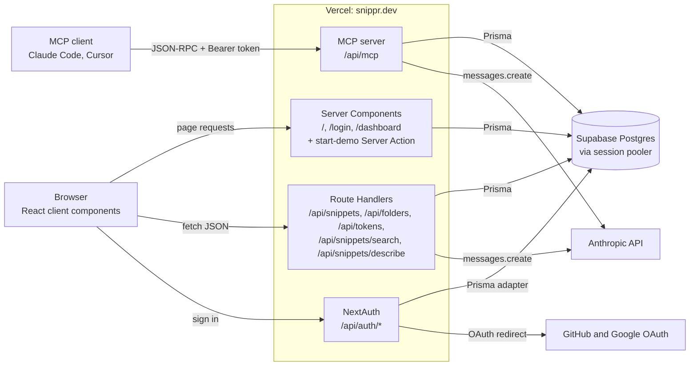
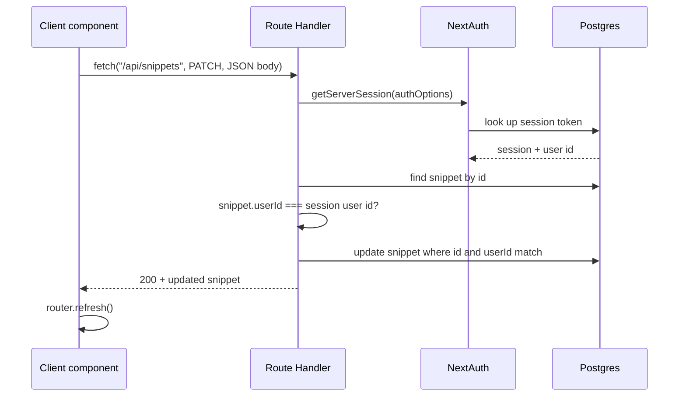
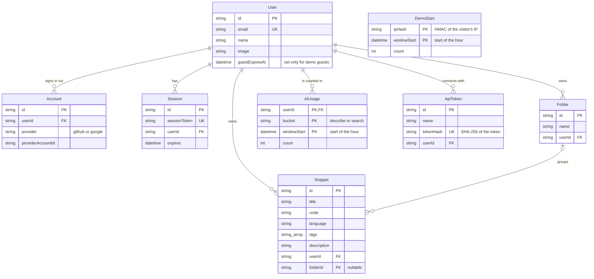
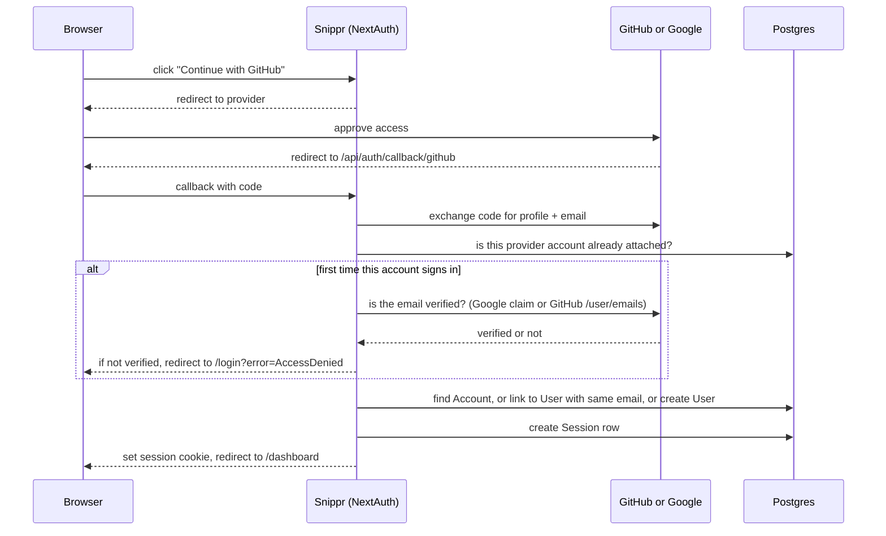

# Architecture

This document describes how Snippr is put together **today**. For *why* it's built this way, follow the links to the [decision records](./adr/README.md). For what's changing next, see the [roadmap](./ROADMAP.md).

*Last reviewed: 2026-10-23 (after ADR 0032)*

## The short version

Snippr is a single Next.js 16 application deployed on Vercel. Pages render on the server and read from a Supabase Postgres database through Prisma. The browser changes data by calling a small set of JSON endpoints in the same app. Two of those endpoints call the Anthropic API for AI search and AI-written descriptions. Users sign in with GitHub or Google through NextAuth, or start a 24-hour demo as a guest without signing in. MCP clients like Claude Code and Cursor reach the same library through an MCP server in the same app, signed in with a token the user makes. Every database query is scoped to the signed-in user.

## System overview



| Piece | What it does | Decision |
| --- | --- | --- |
| Next.js App Router | Serves pages and the API from one app | [0002](./adr/0002-nextjs-full-stack-on-vercel.md) |
| Prisma 5 + Supabase Postgres | Stores users, sessions, snippets, folders | [0003](./adr/0003-supabase-postgres-with-prisma-5.md) |
| NextAuth v4 | GitHub and Google sign-in, database sessions | [0004](./adr/0004-nextauth-database-sessions-and-account-linking.md) |
| Anthropic API | AI search and AI descriptions | [0005](./adr/0005-ai-features-as-synchronous-claude-calls.md) |
| dnd-kit | Drag snippets onto folders | [0007](./adr/0007-dnd-kit-for-drag-and-drop.md) |
| Demo mode | Expiring guest users, no sign-in needed | [0012](./adr/0012-demo-mode-as-expiring-guest-users.md) |
| Shiki | Syntax highlighting: cards on the server, the preview modal in the browser | [0022](./adr/0022-highlight-cards-on-the-server.md) |
| zod | Checks every API request body | [0014](./adr/0014-validate-request-bodies-with-zod.md) |
| MCP SDK | The MCP server MCP clients connect to, signed in by token | [0024](./adr/0024-remote-mcp-server-with-personal-access-tokens.md) |

## How a request flows

### Loading the dashboard (read path)

1. The browser requests `/dashboard`.
2. `src/app/dashboard/page.tsx` is a **Server Component**: it runs only on the server. It calls `getServerSession(authOptions)`, which reads the session cookie and looks the session up in Postgres. No session means a redirect to `/login`.
3. It loads the user's snippets and folders (with snippet counts) in parallel with `Promise.all`, then highlights the start of each snippet's code with Shiki for its card ([0022](./adr/0022-highlight-cards-on-the-server.md)).
4. It passes that data as props to `DashboardClient`, a **Client Component** that runs in the browser and owns all the interactive state: search text, AI mode, selected folder, sidebar collapse, the phone folder drawer, the new-snippet modal, and drag state. Each `SnippetCard` owns its own preview and edit modals.
5. `DashboardClient` is rendered to HTML on the server too, so the snippets arrive with the page, and then **hydrates** in the browser: React attaches its event handlers to that HTML instead of drawing it again. That only works if both renders produce the same markup, which is why `DndContext` has a fixed `id` ([0007](./adr/0007-dnd-kit-for-drag-and-drop.md)). So a remembered choice the first frame depends on lives in a cookie the server can read, not in `localStorage`: the theme ([0029](./adr/0029-remember-the-theme-in-a-cookie-and-highlight-code-in-both.md)) and the collapsed sidebar (`src/lib/sidebar.ts`, read by the dashboard page).

Filtering by folder and keyword search both happen **in the browser** over the snippets already loaded, and keyword search stays inside the open folder. Only AI search makes a network call, and it always searches the whole library: you reach for it when you don't remember where something is, and the MCP server's search works the same way. While its results are up the heading reads "Whole library" instead of the folder's name, and picking a folder clears them. Its results are kept as ids and looked up in the loaded snippets, so they follow edits, moves, and deletes like the rest of the grid.

### Changing data (write path)



PATCH is a partial update: fields the request leaves out stay as they are, and `folderId: null` is how you move a snippet to Unorganized. The request schema handles both (`src/lib/schemas.ts`).

`router.refresh()` asks Next.js to re-run the Server Components for the current page and send down fresh data, without a full page reload and without losing client state like the open sidebar. That's how the dashboard picks up changes: the client never edits its own copy of the list.

### Authorization model

Every Route Handler follows the same pattern. For snippets and folders it lives in `src/lib/snippets.ts` and `src/lib/folders.ts`, which get the database passed in as a store, so each step is tested against an in-memory one with two users; the route files only connect them to NextAuth and Prisma ([0018](./adr/0018-route-handler-logic-in-lib-with-a-store.md)). The AI handlers work the same way, in `src/lib/ai-search.ts` and `src/lib/ai-describe.ts` ([0023](./adr/0023-one-ai-module-on-claude-haiku.md)). The steps:

1. **Who are you?** Resolve the session from its cookie, or, for the MCP server only, the user from its token ([0024](./adr/0024-remote-mcp-server-with-personal-access-tokens.md)). No user id means `401`.
2. **Is it the right shape?** Check the body against its zod schema (`src/lib/schemas.ts`). Wrong types, missing fields, oversized fields, or malformed JSON mean `400` with an `error` message. Fields the schema doesn't list are dropped, so a body can't set `userId` ([0014](./adr/0014-validate-request-bodies-with-zod.md)).
3. **Is it yours?** For any record addressed by id, load it and compare its `userId` to the session's. Mismatch or missing means `403`.
4. **Do the work,** scoped by `userId`. Updates and deletes match on both the id and the `userId` (`where: { id, userId }`), so the database refuses someone else's row even if step 3 was skipped or the row changed hands in between. A write that matches nothing is the same `403`.

Lists are always filtered with `where: { userId }`, so one user can never see another's data. Foreign keys in a request body get the same rule: when a snippet is created or updated, its `folderId` must be null or a folder you own, or the request gets a `403` (`src/lib/folder-ownership.ts`; history in [0006](./adr/0006-folders-as-optional-one-to-many.md)).

Creating a snippet when the library is full returns `409`: 50 snippets for members, 10 for demo guests ([0013](./adr/0013-snippet-cap-of-50-for-members-and-10-for-guests.md)). The count and the insert run in one transaction behind a per-user advisory lock, so parallel creates (from an MCP client, say) can't slip past it ([0025](./adr/0025-serialize-snippet-creates-per-user-with-an-advisory-lock.md)). Folders work the same way, with the same numbers ([0014](./adr/0014-validate-request-bodies-with-zod.md)), and MCP tokens stop at 10. Both take the same kind of lock, each with its own key prefix (`src/lib/create-lock.ts`), so a user's folder creates never wait on their snippet ones. Field limits (200-character titles, 20,000 characters of code, and so on) are listed in 0014 and kept in `src/lib/field-limits.ts`, which the UI imports too.

### Errors

Every error is `{ error: string }` with a status code: the status is for programs, the message is for people and is shown as is ([0017](./adr/0017-one-error-shape-shown-inline.md)). Each handler is wrapped in `withErrors` (`src/lib/api-errors.ts`), so anything that throws is logged on the server and answered with `500`, or `502` when the Claude call failed, instead of Next's empty `500`.

| Status | Meaning |
| --- | --- |
| `400` | The body is the wrong shape |
| `401` | Not signed in |
| `403` | The record is missing or someone else's, or a demo guest tried to make a token |
| `409` | The library, the folder list, or the token list is full |
| `429` | Too many AI calls this hour, with `Retry-After` |
| `500` | Something broke on our side |
| `502` | Claude didn't answer |

Pages follow the same idea. A page or Server Action that throws shows `src/app/error.tsx`: Snippr's words, a **Try again** that re-fetches the page from the server, a link home, and the error's `digest`. In production Next hides a server error's message from the browser and sends that hash instead; it matches the error's line in Vercel's logs. The page never shows the message, since a client-side error's message can hold anything. The root layout sits above `error.tsx`, so an error there falls through to Next's built-in `global-error`; the layout only loads fonts and metadata and reads the theme cookie, which falls back to the default theme on any value it doesn't know, so that's an accepted gap.

In the browser, components call the API through `callApi` (`src/lib/api-client.ts`), which returns the data or a message to show. Errors you can fix show next to whatever was being done. Things that happen out of sight, like a drag to a folder or a finished delete, show a toast instead ([0021](./adr/0021-hand-rolled-toasts-for-what-happens-out-of-sight.md)).

## Data model



- **Deleting a user** cascades to everything they own.
- **Deleting a folder** sets `folderId` to null on its snippets. Code is never deleted as a side effect.
- `AiUsage` counts AI calls per user, endpoint, and hour for rate limiting ([0011](./adr/0011-rate-limit-ai-endpoints-in-postgres.md)).
- `ApiToken` holds the personal access tokens MCP clients sign in with, as a SHA-256 of each token, never the token itself ([0024](./adr/0024-remote-mcp-server-with-personal-access-tokens.md)).
- `DemoStart` counts demos started per IP and hour. It isn't linked to any user ([0012](./adr/0012-demo-mode-as-expiring-guest-users.md)).
- `Account`, `Session`, and `VerificationToken` are the standard NextAuth adapter tables. `VerificationToken` is unused because there's no email sign-in.
- Every foreign key column has an index, since Postgres doesn't add one for the referencing side. A `test:db` test (`src/lib/foreign-key-indexes.db.test.ts`) fails if a new relation arrives without its `@@index`.
- Schema changes are SQL migrations in `prisma/migrations/`, starting from a baseline of the schema as it stood in October 2026. Production builds apply new ones before building the app ([0016](./adr/0016-apply-migrations-in-the-production-build.md)).

## Authentication



The cookie only holds a random session token. All user data stays in the database. Accounts with the same email are linked into one user ([0004](./adr/0004-nextauth-database-sessions-and-account-linking.md)), with emails stored and matched in lowercase so casing differences between providers don't split an account ([0010](./adr/0010-store-emails-lowercased.md)). To make that safe, a provider account being attached for the first time must come with an email the provider has verified ([0009](./adr/0009-require-verified-email-for-new-accounts.md)). Failed sign-ins return to `/login` with an error code that the page turns into a readable message.

### Demo guests

"Try the demo" on the landing page skips OAuth entirely ([0012](./adr/0012-demo-mode-as-expiring-guest-users.md)):

1. The form posts to a Server Action, `startDemoAction` (`src/app/actions/start-demo.ts`). Next.js rejects it unless it came from our own pages.
2. It counts the start against the visitor's IP (5 an hour, stored as a hash) and deletes guests that have expired.
3. In one transaction it creates a `User` with `guestExpiresAt` 24 hours out, a few seeded folders and snippets, and a `Session` row.
4. It sets the same session cookie NextAuth would and redirects to `/dashboard`. From there the guest is an ordinary signed-in user.

An adapter wrapper (`src/lib/guest.ts`) enforces the rest. Once `guestExpiresAt` has passed, the guest's session counts as no session, even though NextAuth will have pushed the session row's own expiry out. Guests also can't have a GitHub or Google account attached; the dashboard's "Sign in to keep your own" signs the guest out first. The session carries `isGuest`, which the dashboard uses for its banner and the AI handlers use to pick the guest limit.

## AI features

Both features call Claude synchronously from a Route Handler. The API key never reaches the browser.

All Claude calls go through `src/lib/ai.ts` ([0023](./adr/0023-one-ai-module-on-claude-haiku.md)): one client, Claude Haiku 5.5 for both features, thinking off, a 15-second timeout and one retry. A timeout or any other failed call is a `502`. The features take its `askClaude` function as an argument, so their tests use a fake Claude.

- **AI search** (`POST /api/snippets/search`): sends the query and a numbered list of every snippet's title, language, tags, and description. Claude replies with a JSON array of the matching numbers, and the handler maps those back to snippets. A reply that isn't one is logged and shown as no matches. The dashboard runs one search at a time and ignores a reply that arrives after a newer search or after AI mode is switched off (`src/lib/latest-only.ts`).
- **AI descriptions** (`POST /api/snippets/describe`): sends the code and language and asks for one sentence under 15 words.

Each user gets 30 calls an hour per feature, or 10 for demo guests. An empty query or empty code is answered without Claude and isn't counted. The count is kept in the `AiUsage` table with one atomic statement per call; past the limit the handler returns `429` with a `Retry-After` header and Claude is never called. Oversized input gets a `400` first: 20,000 characters of code for descriptions, 1,000 for a search ([0011](./adr/0011-rate-limit-ai-endpoints-in-postgres.md), [0014](./adr/0014-validate-request-bodies-with-zod.md)). Describe also only accepts a language from the dropdown's list, since it goes into the prompt.

Limits and trade-offs of the AI approach itself are in [0005](./adr/0005-ai-features-as-synchronous-claude-calls.md).

## MCP server

`POST /api/mcp` is an [MCP](https://modelcontextprotocol.io) server, so Claude Code, Cursor, and other MCP clients can use the library directly ([0024](./adr/0024-remote-mcp-server-with-personal-access-tokens.md)). It has three tools:

| Tool | What it does | Same rules as |
| --- | --- | --- |
| `search_snippets` | AI search over the whole library, counted against the hourly AI limit | `POST /api/snippets/search` |
| `get_snippet` | One snippet by id, only the caller's | the `403` for anyone else's |
| `save_snippet` | Creates a snippet, with the field limits, folder check, and cap | `POST /api/snippets` |

1. The client sends `Authorization: Bearer snippr_...`. `userForToken` (`src/lib/api-tokens.ts`) hashes it and looks up the hash. No token, an unknown one, or a guest's means `401` with `WWW-Authenticate: Bearer`, before any MCP code runs.
2. `handleMcpRequest` (`src/lib/mcp.ts`) builds a fresh server for that user and answers the JSON-RPC request as plain JSON. Nothing is kept between requests, so it works on Vercel's functions. `GET` and `DELETE` get Next's `405`.
3. Each tool builds a `Request` for the same function the Route Handler calls and turns the `Response` back into a tool result. An error's `{ error }` message becomes the tool's error text, and a tool that throws gets the usual "Something broke" message, never the exception's.

Tokens are made and revoked on `/connect`, through `/api/tokens`, which only accepts a browser session. A token is `snippr_` and 32 random bytes, shown once; up to 10 per user; demo guests can't make any. The Connect page also shows what to paste into Claude Code and Cursor (`src/lib/mcp-config.ts`).

## Styling

Components are styled with Tailwind, but never with its palette ([0027](./adr/0027-one-default-identity-and-an-8-bit-theme-on-semantic-tokens.md)). `globals.css` defines design tokens as CSS variables named by role: surfaces (`page`, `surface`, `surface-raised`, `code`), lines, three text levels (`fg`, `fg-muted`, `fg-subtle`), accent, inverse, danger, warning, display, title, and body fonts, three corner radii, a border width, shadows, and a few the 8-bit theme uses and the default leaves off (a page pattern, uppercase controls, a lip under primary buttons). `@theme inline` turns them into utilities (`bg-surface`, `text-fg-muted`, `rounded-box`, `shadow-popover`) that read the variable at runtime, so a theme only has to override the variables. Tailwind's own palette is switched off, so `bg-gray-800` builds to nothing, and a test fails on any palette class in a `.tsx` file.

The default identity is "cut and keep" ([0028](./adr/0028-cut-and-keep-as-the-default-identity.md)): blue-black ink surfaces, warm off-white text, one tangerine accent, Space Grotesk for the wordmark and page headings (`font-display`), Geist for everything else, and Shiki's `ayu-dark` for code. The logo is `src/components/LogoMark.tsx`, which takes its colors as props so the headers, the favicon (`icon.tsx`), the Apple touch icon (`apple-icon.tsx`), and the Open Graph image all draw the same shape.

Those images are drawn by `next/og` at build time and can't read CSS, so `src/lib/theme-tokens.ts` holds a copy of the default theme's colors, and a test keeps it equal to `globals.css`. The same test checks every text and background pairing the components use against WCAG AA (`src/lib/contrast.ts`). `next/og` can't use `next/font` either, so the Open Graph image loads its fonts from `assets/fonts`.

The 8-bit theme is a `[data-theme="8bit"]` block in `globals.css` that overrides every color token, plus the shape and type ones ([0030](./adr/0030-commit-the-8-bit-theme-to-sweetie-16-and-pixel-ui-text.md)): the Sweetie 16 palette on a dot grid, square corners, three-pixel borders, hard shadows, buttons with a lip, Press Start 2P for headings and titles, and VT323 for interface text. Code stays in Geist Mono. The Wordmark draws pixel scissors instead of the bracket in this theme. The contrast test runs every pairing against it too, reading its values straight from the CSS ([0029](./adr/0029-remember-the-theme-in-a-cookie-and-highlight-code-in-both.md)). The toggle (`ThemeToggle`, on the dashboard and the landing page) writes a `snippr-theme` cookie and the attribute in the browser, with no request. The root layout reads the cookie, so the server draws the page in the chosen theme from the first frame; that's also why every route is dynamic. Code is highlighted with both palettes in one pass: Shiki writes `ayu-dark` inline and the 8-bit color as `--shiki-8bit`, and one rule in `globals.css` switches to it.

## Code map

```
.github/workflows/ci.yml        CI: formatting, lint, types, unit tests, migrations, store tests, e2e, dependency audit
.git-blame-ignore-revs          Formatting-only commits for git blame to skip
assets/fonts/                   Font files and licenses for the Open Graph image, which can't use next/font
.prettierignore                 What Prettier leaves alone: Markdown, the lockfile
docker-compose.yml              Local Postgres for development and tests
docs/images/                    The README's screenshots and GIF, made by e2e/readme-images.ts
e2e/
├── demo.spec.ts                End-to-end test: demo, open a card and reach a folder's ⋯ from the keyboard, create, search, drag into a folder, Tab stays in dialogs
├── phone.spec.ts               The dashboard at phone width: no sideways scroll, folder drawer, delete from preview and form
├── readme-images.ts            Not a test: takes the README's screenshots and GIF (npm run readme-images)
└── theme.spec.ts               The 8-bit theme at phone width: survives a reload, no sideways scroll
playwright.config.ts            Runs it against a production build on port 3100
playwright.images.config.ts     The same build and database, for readme-images.ts only
prisma/
├── migrations/                 SQL migrations, starting from the 0_init baseline
└── schema.prisma               Data model (source of truth)
scripts/
├── check-db.mjs                Stops database scripts aimed at a remote database
├── db-guard.mjs                The rules it follows (tested)
├── deploy-migrations.mjs       Applies pending migrations during production builds
├── migrate-gate.mjs            Which builds migrate: only Vercel production (tested)
├── e2e-db.mjs                  Wipes and migrates the end-to-end database
├── e2e-guard.mjs               Keeps that to a local database named *_e2e (tested)
├── test-db-guard.mjs           The rule for any database a test run wipes (tested)
├── test-db-reset.mjs           Wipes and migrates the store tests' database
└── test-db-worker-check.mjs    Re-checks it inside each test worker
src/
├── app/
│   ├── page.tsx                Landing page; signed-in users go to /dashboard
│   ├── login/page.tsx          Sign-in page
│   ├── actions/start-demo.ts   Server Action: create a guest and sign in as it
│   ├── dashboard/page.tsx      Server Component: auth check + data load
│   ├── connect/page.tsx        MCP tokens: make one, see what to paste, revoke
│   ├── layout.tsx              Root layout, fonts, metadata and link previews, the theme from its cookie
│   ├── error.tsx               What a page that throws shows: retry, a way home, a log reference (tested)
│   ├── opengraph-image.tsx     Link preview image, rendered at build time from the theme tokens
│   ├── icon.tsx, apple-icon.tsx  Favicon and home screen icon, drawn from LogoMark at build time
│   ├── globals.css             Tailwind v4 entry, the design tokens, global styles
│   └── api/
│       ├── auth/[...nextauth]/ NextAuth handler
│       ├── folders/            Folder CRUD (logic in lib/folders.ts)
│       ├── mcp/                MCP server, signed in by token (logic in lib/mcp.ts)
│       ├── tokens/             Make, list, and revoke MCP tokens (logic in lib/api-tokens.ts)
│       └── snippets/
│           ├── route.ts        Snippet CRUD (logic in lib/snippets.ts)
│           ├── search/         AI search (logic in lib/ai-search.ts)
│           └── describe/       AI descriptions (logic in lib/ai-describe.ts)
├── components/
│   ├── DashboardClient.tsx     Interactive dashboard, DnD context (tested: two server renders match)
│   ├── ConnectClient.tsx       The Connect page's token form, new-token panel, and list
│   ├── FolderSidebar.tsx       Collapsible sidebar (a drawer on phones), drop targets
│   ├── SnippetCard.tsx         Draggable card with edit, delete, copy; Enter or Space opens the preview
│   ├── SnippetCardView.tsx     Card markup only, shared with the landing page
│   ├── SnippetModal.tsx        Preview, highlighted in the browser, plain code if that fails
│   ├── useCopy.ts              Copy button shared by the card and preview, toast if it fails
│   ├── useDeleteSnippet.ts     Two-step delete shared by the card, preview, and edit form
│   ├── useDialogFocus.ts       Focus into the preview and form, the page behind inert while open, focus back on close
│   ├── Toaster.tsx             ToastProvider and useToast(), dashboard and Connect page
│   ├── DemoButton.tsx          "Try the demo" form on the landing page
│   ├── SnippetFormModal.tsx    New and edit form, labelled fields, unsaved-change guard (click outside, Escape), delete when editing
│   ├── accessible-names.test.ts  Every field and button on the forms, preview, and dashboard has a name
│   ├── LogoMark.tsx            The logo, colors passed in, and the Wordmark for page headers
│   ├── ThemeToggle.tsx         ThemeProvider and the 8-bit toggle: cookie and data-theme, in the browser
│   └── LoginButton.tsx         OAuth buttons
├── lib/
│   ├── ai.ts                   The one Claude client: model, timeout, retries, askClaude()
│   ├── ai-describe.ts          /api/snippets/describe: sign-in, validation, rate limit, in order (tested)
│   ├── ai-results.ts           AI search results as ids, looked up in the current snippets (tested)
│   ├── ai-search.ts            /api/snippets/search and the MCP search tool (tested)
│   ├── accessible-names.ts     unnamedControls: fields and buttons with no name in rendered HTML (tested)
│   ├── ai-usage.ts             Atomic AI usage counter (SQL, tested against Postgres)
│   ├── api-client.ts           callApi: how components call the API and read its errors (tested)
│   ├── api-tokens.ts           MCP tokens: make, hash, revoke, sign in by Bearer header (tested)
│   ├── api-errors.ts           The error shape, 401 and 429 responses, the withErrors wrapper (tested)
│   ├── auth.ts                 NextAuth config, verified-email check, currentUser()
│   ├── card-keys.ts            Which keys open a card, and what screen readers hear on one (tested)
│   ├── create-lock.ts          withUserLock: the per-user advisory lock every capped create runs under (docs/adr/0025)
│   ├── contrast.ts             WCAG contrast ratio between two colors (tested)
│   ├── clipboard.ts            copyText: whether a copy actually landed (tested)
│   ├── demo.ts                 Starting a demo: seed, IP limit, cookie name (tested)
│   ├── demo-store.ts           Database side of starting a demo
│   ├── dialog-focus.ts         focusDialog: focus in and back to an opener still on the page; inertOutside (tested)
│   ├── email-case.ts           Lowercases emails in the NextAuth adapter (tested)
│   ├── email-verification.ts   Provider email verification (tested)
│   ├── empty-state.ts          What the dashboard says when there are no cards to show (tested)
│   ├── field-limits.ts         Field limits and the language list, shared with the UI
│   ├── folder-cap.ts           Folder cap: 50 per member, 10 per guest (tested)
│   ├── folder-delete.ts        What the folder menu says before and after a delete (tested)
│   ├── folder-name-input.ts    What Enter and blur do in the folder name input (tested)
│   ├── folders.ts              /api/folders: ownership, cap, validation, in order (tested)
│   ├── folder-ownership.ts     Folder ownership check for snippet writes (tested)
│   ├── guest.ts                Guest expiry and no-linking rules for the adapter (tested)
│   ├── highlight.ts            Shiki passed in: card previews, both themes' colors, null instead of a throw (tested)
│   ├── landing-samples.ts      Sample snippets for the landing page (tested)
│   ├── latest-only.ts          Keeps only the latest request's answer, for AI search (tested)
│   ├── library-types.ts        The Snippet and Folder types the components share
│   ├── library-store.ts        Database side of snippets.ts and folders.ts (tested against Postgres)
│   ├── mcp.ts                  The MCP server: token sign-in, three tools on the API's functions (tested)
│   ├── mcp-config.ts           What to paste into each MCP client (tested)
│   ├── rate-limit.ts           Rate-limit windows and decisions, member and guest AI limits (tested)
│   ├── request-body.ts         Reads a JSON body and checks it against a schema, or returns a 400 (tested)
│   ├── security-headers.ts     Headers on every response, applied in next.config.ts (tested)
│   ├── sign-in-errors.ts       Login error messages (tested)
│   ├── site.ts                 Site URL, name, and description for metadata (tested)
│   ├── snippet-form.ts         The snippet form's starting fields, change check, and request body (tested)
│   ├── snippet-cap.ts          Snippet cap: 50 per member, 10 per guest (tested)
│   ├── snippets.ts             /api/snippets: ownership, cap, validation, in order (tested)
│   ├── schemas.ts              zod schemas for every request body (tested)
│   ├── shiki-8bit.ts           The 8-bit theme's syntax colors (tested: AA on the code background)
│   ├── theme.ts                The theme list and its cookie (tested)
│   ├── sidebar.ts              The collapsed sidebar's cookie, read by the dashboard page (tested)
│   ├── theme-tokens.ts         The default theme's colors for the generated images (tested: match globals.css, WCAG AA in both themes, no palette classes)
│   ├── token-store.ts          Database side of api-tokens.ts (tested against Postgres)
│   ├── toasts.ts               Toast queue: limit, duplicates, how long each stays (tested)
│   └── prisma.ts               Prisma client singleton
└── types/next-auth.d.ts        Adds user.id to the Session type
vitest.config.mts               npm test: the *.test.ts files next to the code
vitest.db.config.mts            npm run test:db: *.db.test.ts against a local snippr_test
```

## Deployment and environments

| Environment | Where | Deploys from | Database |
| --- | --- | --- | --- |
| Production | snippr.dev | `main` | Supabase project `Snippr` |
| Local | `localhost:3000` | your machine | Postgres 17 in Docker (`docker-compose.yml`) |
| CI | GitHub Actions | nothing; runs on every push | Postgres 17 service container, empty every run |

Secrets live in Vercel environment variables, marked Sensitive, and in a local `.env` that is never committed. `.env.example` lists every required variable. See [DEVELOPMENT.md](./DEVELOPMENT.md).

Every response carries the headers in `src/lib/security-headers.ts`: no site may frame Snippr, no content sniffing, a referrer policy, and a permissions policy. Vercel adds `Strict-Transport-Security`. There's no full Content Security Policy, only `frame-ancestors`; [0031](./adr/0031-send-security-headers-without-a-full-csp.md) explains why.

Every push runs `.github/workflows/ci.yml`. Vercel builds at the same time, and its Deployment Checks hold a production build until the test jobs pass ([0020](./adr/0020-ci-on-github-actions-gating-production-deploys.md)). That's a Vercel dashboard setting, so the repo can't show it's on. A third job audits the production dependencies and doesn't hold anything up ([0026](./adr/0026-audit-production-dependencies-in-ci.md)). If a push never starts a run, `gh workflow run ci.yml` starts one by hand.

Production's `DATABASE_URL` lives only in Vercel. Production builds use it to apply pending migrations before `next build`; preview and local builds skip that step ([0016](./adr/0016-apply-migrations-in-the-production-build.md)). The npm scripts that connect (`dev`, `start`, `db:migrate`, `db:studio`) run `scripts/check-db.mjs` first, which refuses any database that isn't on this machine unless `ALLOW_REMOTE_DB=1` is set in the shell ([0015](./adr/0015-local-postgres-in-docker-for-development.md)).

## Known limitations

The October 2026 audit findings live in the [roadmap](./ROADMAP.md), each linked to the decision record that explains it. The most important one: AI search has no end-to-end coverage. Its handler is tested against a fake Claude, but no test drives it through the browser. `npm run readme-images` does, against the real Claude, to take the README's screenshot, but it runs by hand and not in CI. Demo guests also write anonymously to the production database, bounded by the per-IP limit, the snippet and folder caps, and the field limits.
