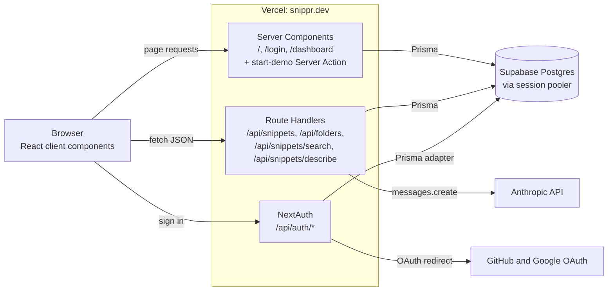
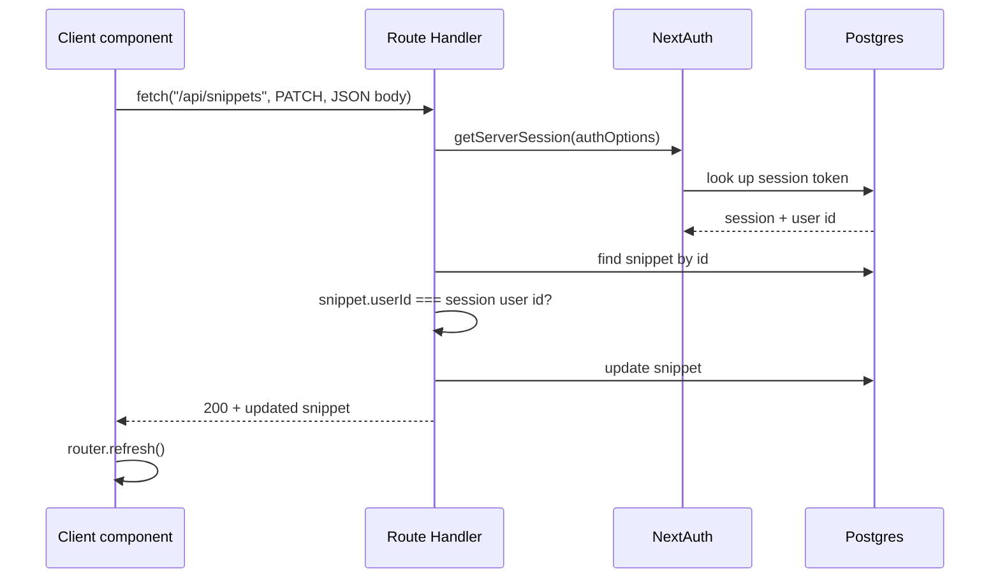
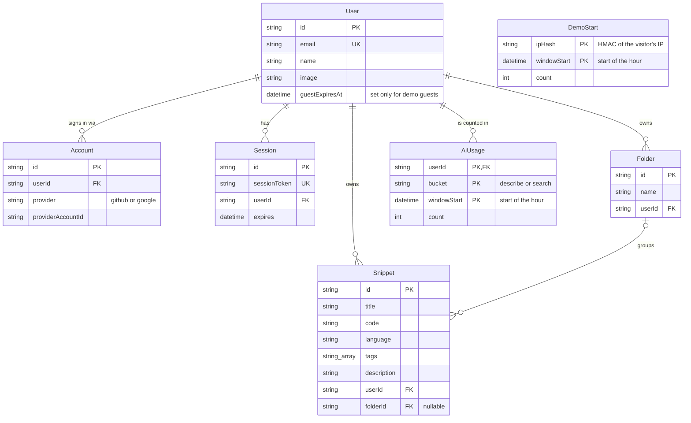
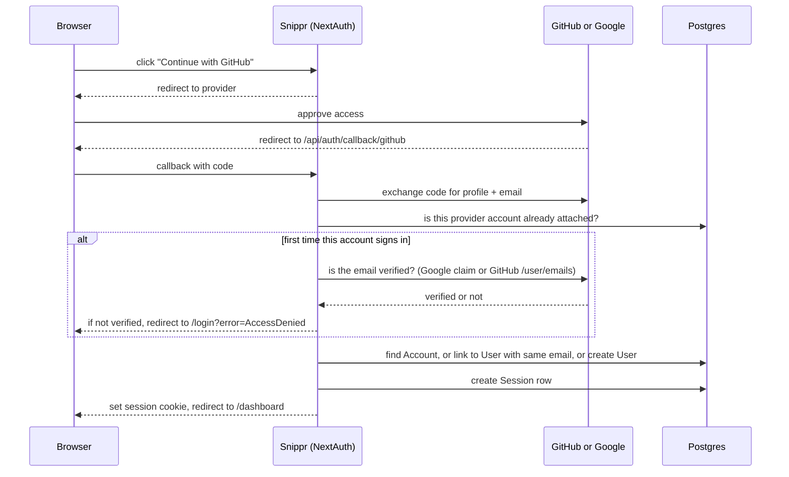

# Architecture

This document describes how Snippr is put together **today**. For *why* it's built this way, follow the links to the [decision records](./adr/README.md). For what's changing next, see the [roadmap](./ROADMAP.md).

*Last reviewed: 2026-10-18 (after ADR 0013)*

## The short version

Snippr is a single Next.js 16 application deployed on Vercel. Pages render on the server and read from a Supabase Postgres database through Prisma. The browser changes data by calling a small set of JSON endpoints in the same app. Two of those endpoints call the Anthropic API for AI search and AI-written descriptions. Users sign in with GitHub or Google through NextAuth, or start a 24-hour demo as a guest without signing in. Every database query is scoped to the signed-in user.

## System overview



| Piece | What it does | Decision |
| --- | --- | --- |
| Next.js App Router | Serves pages and the API from one app | [0002](./adr/0002-nextjs-full-stack-on-vercel.md) |
| Prisma 5 + Supabase Postgres | Stores users, sessions, snippets, folders | [0003](./adr/0003-supabase-postgres-with-prisma-5.md) |
| NextAuth v4 | GitHub and Google sign-in, database sessions | [0004](./adr/0004-nextauth-database-sessions-and-account-linking.md) |
| Anthropic API | AI search and AI descriptions | [0005](./adr/0005-ai-features-as-synchronous-claude-calls.md) |
| dnd-kit | Drag snippets onto folders | [0007](./adr/0007-dnd-kit-for-drag-and-drop.md) |
| Demo mode | Expiring guest users, no sign-in needed | [0012](./adr/0012-demo-mode-as-expiring-guest-users.md) |
| Shiki | Syntax highlighting in the preview modal | n/a |
| zod | Checks every API request body | [0014](./adr/0014-validate-request-bodies-with-zod.md) |

## How a request flows

### Loading the dashboard (read path)

1. The browser requests `/dashboard`.
2. `src/app/dashboard/page.tsx` is a **Server Component**: it runs only on the server. It calls `getServerSession(authOptions)`, which reads the session cookie and looks the session up in Postgres. No session means a redirect to `/login`.
3. It loads the user's snippets and folders (with snippet counts) in parallel with `Promise.all`.
4. It passes that data as props to `DashboardClient`, a **Client Component** that runs in the browser and owns all the interactive state: search text, AI mode, selected folder, sidebar collapse, the new-snippet modal, and drag state. Each `SnippetCard` owns its own preview and edit modals.

Filtering by folder and keyword search both happen **in the browser** over the snippets already loaded. Only AI search makes a network call.

### Changing data (write path)



PATCH is a partial update: fields the request leaves out stay as they are, and `folderId: null` is how you move a snippet to Unorganized. The request schema handles both (`src/lib/schemas.ts`).

`router.refresh()` asks Next.js to re-run the Server Components for the current page and send down fresh data, without a full page reload and without losing client state like the open sidebar. That's how the dashboard picks up changes: the client never edits its own copy of the list.

### Authorization model

Every Route Handler follows the same pattern:

1. **Who are you?** Resolve the session. No user id means `401`.
2. **Is it the right shape?** Check the body against its zod schema (`src/lib/schemas.ts`). Wrong types, missing fields, oversized fields, or malformed JSON mean `400` with an `error` message. Fields the schema doesn't list are dropped, so a body can't set `userId` ([0014](./adr/0014-validate-request-bodies-with-zod.md)).
3. **Is it yours?** For any record addressed by id, load it and compare its `userId` to the session's. Mismatch or missing means `403`.
4. **Do the work,** scoped by `userId`.

Lists are always filtered with `where: { userId }`, so one user can never see another's data. Foreign keys in a request body get the same rule: when a snippet is created or updated, its `folderId` must be null or a folder you own, or the request gets a `403` (`src/lib/folder-ownership.ts`; history in [0006](./adr/0006-folders-as-optional-one-to-many.md)).

Creating a snippet when the library is full returns `409`: 50 snippets for members, 10 for demo guests ([0013](./adr/0013-snippet-cap-of-50-for-members-and-10-for-guests.md)). Folders work the same way, with the same numbers ([0014](./adr/0014-validate-request-bodies-with-zod.md)). Field limits (200-character titles, 20,000 characters of code, and so on) are listed in 0014 and kept in `src/lib/field-limits.ts`, which the UI imports too.

### Errors

Every error is `{ error: string }` with a status code: the status is for programs, the message is for people and is shown as is ([0017](./adr/0017-one-error-shape-shown-inline.md)). Each handler is wrapped in `withErrors` (`src/lib/api-errors.ts`), so anything that throws is logged on the server and answered with `500`, or `502` when the Claude call failed, instead of Next's empty `500`.

| Status | Meaning |
| --- | --- |
| `400` | The body is the wrong shape |
| `401` | Not signed in |
| `403` | The record is missing or someone else's |
| `409` | The library or folder list is full |
| `429` | Too many AI calls this hour, with `Retry-After` |
| `500` | Something broke on our side |
| `502` | Claude didn't answer |

In the browser, components call the API through `callApi` (`src/lib/api-client.ts`), which returns the data or a message to show, and show that message next to whatever was being done.

## Data model



- **Deleting a user** cascades to everything they own.
- **Deleting a folder** sets `folderId` to null on its snippets. Code is never deleted as a side effect.
- `AiUsage` counts AI calls per user, endpoint, and hour for rate limiting ([0011](./adr/0011-rate-limit-ai-endpoints-in-postgres.md)).
- `DemoStart` counts demos started per IP and hour. It isn't linked to any user ([0012](./adr/0012-demo-mode-as-expiring-guest-users.md)).
- `Account`, `Session`, and `VerificationToken` are the standard NextAuth adapter tables. `VerificationToken` is unused because there's no email sign-in.
- Schema changes are SQL migrations in `prisma/migrations/`, starting from a baseline of the schema as it stood in October 2026. Production builds apply new ones before building the app ([0016](./adr/0016-apply-migrations-in-the-production-build.md)).

## Authentication



The cookie only holds a random session token. All user data stays in the database. Accounts with the same email are linked into one user ([0004](./adr/0004-nextauth-database-sessions-and-account-linking.md)), with emails stored and matched in lowercase so casing differences between providers don't split an account ([0010](./adr/0010-store-emails-lowercased.md)). To make that safe, a provider account being attached for the first time must come with an email the provider has verified ([0009](./adr/0009-require-verified-email-for-new-accounts.md)). Failed sign-ins return to `/login` with an error code that the page turns into a readable message.

### Demo guests

"Try the demo" on the landing page skips OAuth entirely ([0012](./adr/0012-demo-mode-as-expiring-guest-users.md)):

1. The form posts to a Server Action, `startDemoAction` (`src/app/actions/start-demo.ts`). Next.js rejects it unless it came from our own pages.
2. It counts the start against the visitor's IP (5 an hour, stored as a hash) and deletes guests that have expired.
3. In one transaction it creates a `User` with `guestExpiresAt` 24 hours out, a few seeded folders and snippets, and a `Session` row.
4. It sets the same session cookie NextAuth would and redirects to `/dashboard`. From there the guest is an ordinary signed-in user.

An adapter wrapper (`src/lib/guest.ts`) enforces the rest. Once `guestExpiresAt` has passed, the guest's session counts as no session, even though NextAuth will have pushed the session row's own expiry out. Guests also can't have a GitHub or Google account attached; the dashboard's "Sign in to keep your own" signs the guest out first. The session carries `isGuest`, which the dashboard uses for its banner and the AI handlers use to pick the guest limit.

## AI features

Both features call Claude synchronously from a Route Handler. The API key never reaches the browser.

- **AI search** (`POST /api/snippets/search`): sends the query and a numbered list of every snippet's title, language, tags, and description. Claude replies with a JSON array of the matching numbers, and the handler maps those back to snippets.
- **AI descriptions** (`POST /api/snippets/describe`): sends the code and language and asks for one sentence under 15 words.

Each user gets 30 calls an hour per feature, or 10 for demo guests. The count is kept in the `AiUsage` table with one atomic statement per call; past the limit the handler returns `429` with a `Retry-After` header and Claude is never called. Oversized input gets a `400` first: 20,000 characters of code for descriptions, 1,000 for a search ([0011](./adr/0011-rate-limit-ai-endpoints-in-postgres.md), [0014](./adr/0014-validate-request-bodies-with-zod.md)). Describe also only accepts a language from the dropdown's list, since it goes into the prompt.

Limits and trade-offs of the AI approach itself are in [0005](./adr/0005-ai-features-as-synchronous-claude-calls.md).

## Code map

```
docker-compose.yml              Local Postgres for development
prisma/
└── schema.prisma               Data model (source of truth)
scripts/
├── check-db.mjs                Stops database scripts aimed at a remote database
└── db-guard.mjs                The rules it follows (tested)
src/
├── app/
│   ├── page.tsx                Landing page; signed-in users go to /dashboard
│   ├── login/page.tsx          Sign-in page
│   ├── actions/start-demo.ts   Server Action: create a guest and sign in as it
│   ├── dashboard/page.tsx      Server Component: auth check + data load
│   ├── layout.tsx              Root layout, fonts, metadata and link previews
│   ├── opengraph-image.tsx     Link preview image, rendered at build time
│   ├── globals.css             Tailwind v4 entry + global styles
│   └── api/
│       ├── auth/[...nextauth]/ NextAuth handler
│       ├── folders/            Folder CRUD + folder cap
│       └── snippets/
│           ├── route.ts        Snippet CRUD + snippet cap
│           ├── search/         AI search, rate-limited
│           └── describe/       AI descriptions, rate-limited
├── components/
│   ├── DashboardClient.tsx     Interactive dashboard, DnD context
│   ├── FolderSidebar.tsx       Collapsible sidebar, drop targets
│   ├── SnippetCard.tsx         Draggable card with edit, delete, copy
│   ├── SnippetCardView.tsx     Card markup only, shared with the landing page
│   ├── SnippetModal.tsx        Shiki-highlighted preview
│   ├── DemoButton.tsx          "Try the demo" form on the landing page
│   ├── NewSnippetModal.tsx     Create form
│   ├── EditSnippetModal.tsx    Edit form, unsaved-change guard
│   └── LoginButton.tsx         OAuth buttons
├── lib/
│   ├── ai-usage.ts             Atomic AI usage counter (SQL)
│   ├── api-client.ts           callApi: how components call the API and read its errors (tested)
│   ├── api-errors.ts           The error shape, 401 and 429 responses, the withErrors wrapper (tested)
│   ├── auth.ts                 NextAuth config, verified-email check
│   ├── demo.ts                 Starting a demo: seed, IP limit, cookie name (tested)
│   ├── demo-store.ts           Database side of starting a demo
│   ├── email-case.ts           Lowercases emails in the NextAuth adapter (tested)
│   ├── email-verification.ts   Provider email verification (tested)
│   ├── field-limits.ts         Field limits and the language list, shared with the UI
│   ├── folder-cap.ts           Folder cap: 50 per member, 10 per guest (tested)
│   ├── folder-ownership.ts     Folder ownership check for snippet writes (tested)
│   ├── guest.ts                Guest expiry and no-linking rules for the adapter (tested)
│   ├── landing-samples.ts      Sample snippets for the landing page (tested)
│   ├── rate-limit.ts           Rate-limit windows and decisions, member and guest AI limits (tested)
│   ├── request-body.ts         Reads a JSON body and checks it against a schema, or returns a 400 (tested)
│   ├── sign-in-errors.ts       Login error messages (tested)
│   ├── site.ts                 Site URL, name, and description for metadata (tested)
│   ├── snippet-cap.ts          Snippet cap: 50 per member, 10 per guest (tested)
│   ├── schemas.ts              zod schemas for every request body (tested)
│   └── prisma.ts               Prisma client singleton
└── types/next-auth.d.ts        Adds user.id to the Session type
```

## Deployment and environments

| Environment | Where | Deploys from | Database |
| --- | --- | --- | --- |
| Production | snippr.dev | `main` | Supabase project `Snippr` |
| Local | `localhost:3000` | your machine | Postgres 17 in Docker (`docker-compose.yml`) |

Secrets live in Vercel environment variables, marked Sensitive, and in a local `.env` that is never committed. `.env.example` lists every required variable. See [DEVELOPMENT.md](./DEVELOPMENT.md).

Production's `DATABASE_URL` lives only in Vercel. Production builds use it to apply pending migrations before `next build`; preview and local builds skip that step ([0016](./adr/0016-apply-migrations-in-the-production-build.md)). The npm scripts that connect (`dev`, `start`, `db:migrate`, `db:studio`) run `scripts/check-db.mjs` first, which refuses any database that isn't on this machine unless `ALLOW_REMOTE_DB=1` is set in the shell ([0015](./adr/0015-local-postgres-in-docker-for-development.md)).

## Known limitations

The October 2026 audit findings live in the [roadmap](./ROADMAP.md), each linked to the decision record that explains it. The most important ones: thin test coverage and no CI. Demo guests also write anonymously to the production database, bounded by the per-IP limit, the snippet and folder caps, and the field limits.
